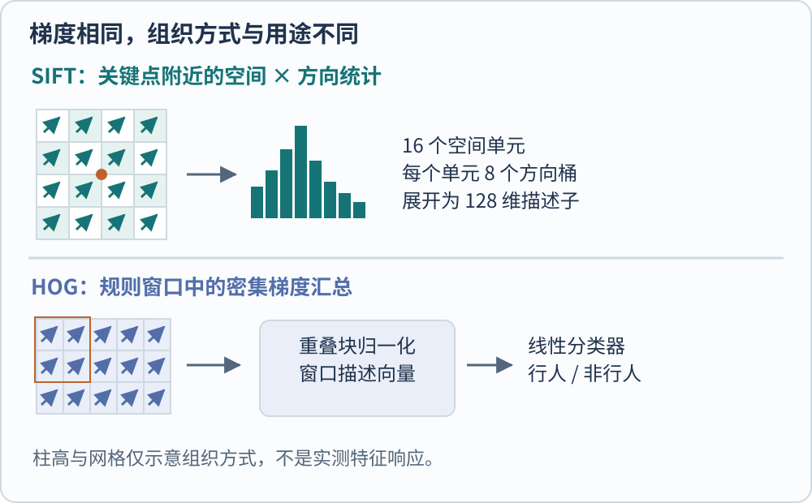
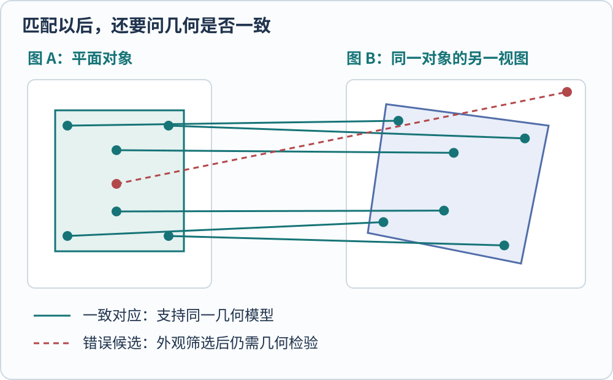

**经典特征方法先把图像中的局部结构转换成可比较的描述，再进行匹配、分类或几何估计。** 特征设计会提前规定哪些变化不应改变判断，并在计算描述时尽量消除这些变化的影响。

例如，识别另一张照片里的同一本书封面，通常需要承受缩放、旋转和部分遮挡。判断一块区域是不是行人，则需要在外形变化中保留身体轮廓。两个任务都能使用梯度信息，但不应该使用同一种输出或同一套成功标准。

## 梯度记录变化，不直接记录对象

灰度图可以看作二维函数 $I(x,y)$，值表示位置 $(x,y)$ 的亮度。相邻位置的差分近似梯度，例如水平方向变化可写为 $g_x=I(x+1,y)-I(x-1,y)$。配合竖直方向的 $g_y$，可以计算变化强度与方向。

设一行教学像素为 $[0,0,1,1,1]$，中间附近的差分会在亮暗交界处产生响应。它告诉我们“这里亮度变化明显”，还没有告诉我们“这里一定是物体轮廓”。阴影、纹理、反光都可能制造变化；同一物体的边缘也可能因为背景颜色接近而变弱。

特征设计由此出现一个取舍。保留每一个像素位置，描述会对小位移很敏感；把一个局部区域里的方向汇总起来，则能容忍细小变化，却会失去一部分精确空间信息。SIFT 与 HOG 都使用了这种汇总思想，只是采样位置和后续用途不同。[@loweSift2004; @dalalHog2005]

*图 1　原创教学示意。上部在一个关键点附近组织方向统计，下部在规则窗口里密集统计；图中的柱高仅示意统计方式，不是运行结果。*

## SIFT 先回答“在哪个尺度看哪里”

SIFT 的全称是 Scale-Invariant Feature Transform。它在尺度空间中寻找稳定候选。图像被以不同程度平滑，邻近尺度的高斯差分帮助寻找在位置和尺度上都显著的结构；不稳定、低对比度或过分像边缘的候选会被过滤。[@loweSift2004]

找到候选后，算法再根据附近梯度分配主方向。这样，描述子使用的是相对于该方向的局部坐标，而不是始终以照片的上边缘为基准。照片旋转时，局部参照也跟着变化，才有可能保持描述的可比性。

常见 SIFT 描述子把局部区域分成 $4\times4$ 个空间单元，每个单元用 8 个方向桶统计，合起来得到

$$
4\times4\times8=128
$$

维描述向量。这个长度来自一个局部邻域的空间与方向统计。归一化等步骤进一步降低某些亮度变化的影响。具体实现与步骤可对照 OpenCV 官方说明。[@opencvSift413]

尺度和旋转不变性也有条件。图像离散采样、模糊和严重视角变化都可能使原来的局部结构不可辨认，进而影响特征匹配。

## 描述子相似，还需要排除歧义

在第二张图中为一个描述子寻找最近邻，只能得到一个“最像”的候选。如果最近与次近的两个候选几乎同样接近，匹配就很含糊。重复窗格、棋盘纹理等情况尤其容易产生这种问题。

比值检验比较最近距离 $d_1$ 与次近距离 $d_2$。用教学阈值 $0.8$ 举例，$d_1=30,d_2=100$ 的比值为 $0.3$，比 $d_1=80,d_2=90$ 的约 $0.889$ 更有区分度。前者通过、后者被拒绝，表达的是相对歧义；它不是匹配正确的概率。阈值也应按图像和实现调整。[@opencvSift413]

通过比值检验的点对仍可能是错的。接下来需要问，它们是否能共同解释一个一致的几何变换。只检查每个点的外观，无法回答这个问题。

## RANSAC 把“很多候选”变成一致性检验

以近似平面的书封面为例，两次拍摄中的点可以尝试用单应矩阵联系。把坐标写成齐次形式后，关系是

$$
\lambda
\begin{bmatrix}x'\\y'\\1\end{bmatrix}
=H
\begin{bmatrix}x\\y\\1\end{bmatrix}.
$$

这里的 $H$ 是 $3\times3$ 矩阵，$\lambda$ 是齐次尺度，不是物体的真实长度。它描述平面在两幅图像中的投影关系。估计时至少需要四个非退化的正确对应，不能用四个几乎共线的点期待稳定结果。OpenCV 的 `findHomography` 示例将特征匹配与这一估计结合。[@opencvHomography413]

RANSAC 即 Random Sample Consensus，反复从少量候选对应中提出模型，再检查哪些点对与模型一致。容许误差内的点称为内点，其余作为外点处理。被接受的是“对同一几何假设有一致支持”的对应集合，而不是所有外观相似的对应。

*图 2　绿色实线表示教学设定中的一致对应，红色虚线表示应拒绝的错误对应。图中点的位置由作者构造，不是某个检测器的精度展示。*

这也说明单应矩阵的边界。拍到的是一排前后距离不同的物体时，不能要求一个平面投影同时解释所有视差；场景运动或错误相机假设还会引入其他问题。算法返回一个矩阵，只证明计算出了一个估计，仍需查看内点分布、重投影误差及对应的场景条件。

## HOG 关心的是整个检测窗口的轮廓统计

HOG 即 Histograms of Oriented Gradients。它把梯度方向在密集网格中汇总，并在重叠块内作归一化，再把描述送给分类器。Dalal 与 Triggs 的原始论文以线性 SVM 行人检测作为研究对象，并逐项比较方向分桶、空间汇总和归一化等选择。[@dalalHog2005]

SIFT 的常见用法是“这个局部位置在另一幅图中对应哪里”；HOG 检测流程则更接近“这个窗口的轮廓分布是否像训练中的行人”。因此不能用 SIFT 关键点多不多来直接判断 HOG 检测是否成功，也不能把 HOG 的窗口分类得分当作每个像素的人体概率。

| 方法或步骤 | 保留的证据 | 需要额外完成的工作 |
| --- | --- | --- |
| 梯度统计 | 局部亮度变化的方向与强度 | 区分阴影、纹理和对象结构 |
| SIFT 描述与匹配 | 局部外观的候选对应 | 检查歧义和几何一致性 |
| 单应估计与 RANSAC | 对某个平面投影假设的支持 | 验证适用场景及估计质量 |
| HOG 与窗口分类器 | 规则窗口的形状统计与类别分数 | 多尺度扫描、去重及任务评估 |

## 今天怎样合理使用这套思路

如果目标是同一平面对象的匹配，流程中的对应点和几何变换本身就有解释价值。若目标是对外观差异很大的语义类别进行识别，就需要能从训练资料中学习更丰富表示的方法。两种选择按任务划分，不应简单用“传统”与“现代”决定。

这篇笔记中最值得保留的习惯是分阶段判断证据。局部统计正确，不等于匹配正确；匹配候选通过筛选，不等于场景满足平面假设；几何一致，也不等于已经理解物体的功能。后来的端到端模型改变了这些阶段的组织方式，这些推断边界仍然有用。

本页没有在图像数据集上运行 SIFT 或 HOG，图件与数值均为解释机制的教学构造，不承担方法性能比较。

[[AI/Vision/index|返回视觉模型专题]]

## 参考文献
