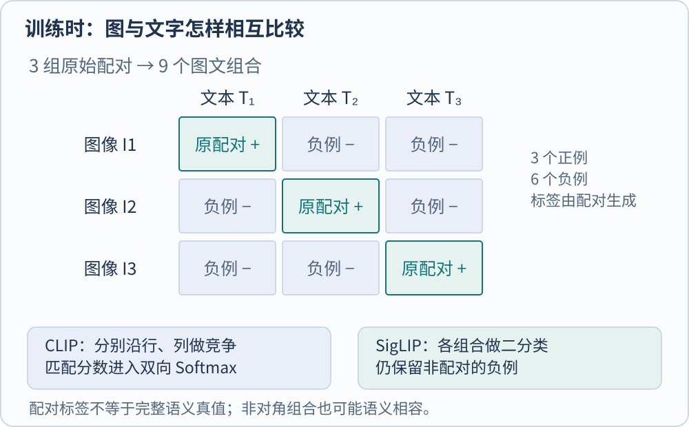
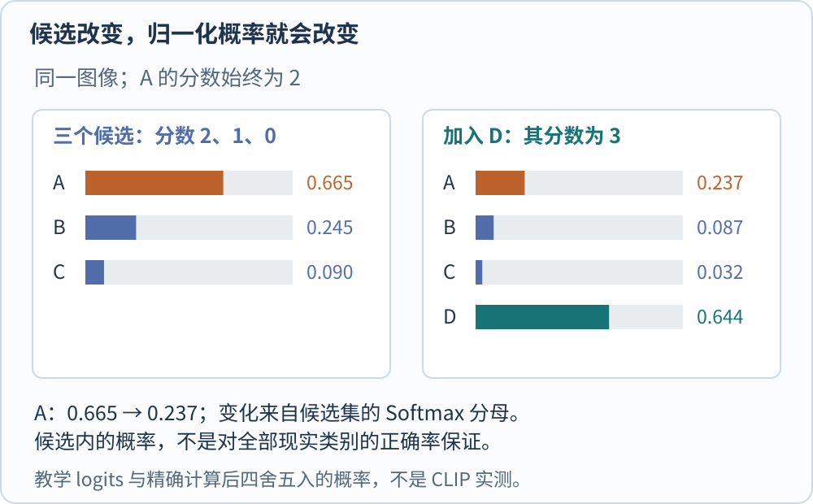

**CLIP 学习图像与文字的可比较表示。** 给它一张图和若干段文字，它能给出匹配分数；原始 CLIP 本身不负责逐字生成答案。其英文全称是 Contrastive Language–Image Pre-training，即对比式语言图像预训练。这里的“对齐”指训练两种编码器，让配对样本在共同空间中有较高相似度，不是把图像位置与句子位置逐项对应。[@radfordClip2021]

设想要从照片中检索“一个放在木桌上的蓝色杯子”。传统封闭分类器可能只有“杯子”这一类，检索需求还包含颜色、材质与关系。图文双编码器允许把完整描述编码成查询，和预先存好的图像向量比较。这为开放描述提供了入口，能否准确区分这些细节，仍受训练数据及表示能力限制。

## 先看训练时哪些东西在比较

一个包含三组图文的批次，有三张图、三条原始配文。图像编码器与文本编码器分别处理输入，再将输出投影到同一维数。计算所有交叉组合后，得到一个 $3\times3$ 分数矩阵。

图中三类配文只用于说明监督关系，不是模型预测。对角线表示数据中原来配对的样本，六个非对角组合被当作负例。一张杯子图如果恰好与另一张杯子图的配文也相容，就会出现“假负例”。因此，训练标签表达的是采集到的配对关系，未必是全部语义真值。SigLIP 原文也明确指出，异图配文不相关这一假设有噪声。[@zhaiSiglip2023]

用 $a_i$ 表示第 $i$ 张图归一化后的向量，$b_j$ 表示第 $j$ 条文本归一化后的向量。两者长度均为 1，点积就是余弦相似度。令 $\tau>0$ 为温度，分数写成 $s_{ij}=a_i^\top b_j/\tau$。一个方向的损失是

$$
\mathcal L_{I\to T}=-\frac1B\sum_{i=1}^{B}\log\frac{\exp(s_{ii})}{\sum_{j=1}^{B}\exp(s_{ij})}.
$$

$B$ 是批内配对数量，分母遍历这张图对应的所有候选文本。它要求模型在这些候选中选中原配文。反过来，固定文本、比较所有图像，会得到 $\mathcal L_{T\to I}$。CLIP 对两者取平均，让两个检索方向都参与学习。温度越小，相同的余弦差异会被放大；它改变训练梯度与输出的尖锐程度，并不增加图像中原本没有的证据。[@radfordClip2021]

这里没有要求图像编码器一定是 ViT。原始研究同时考察了 ResNet 和 ViT。CLIP 描述的是图文预训练路线，ViT 描述的是视觉架构，两者处于不同分类轴上。阅读“CLIP ViT-L/14”时，可以分别理解为训练方式、骨干规模和入口 patch 大小。

## 零样本分类是在临时构造分类器

部署时，可以先把“a photo of a cat”等类别描述编码并缓存。新图像只需算一次向量，便能与这些文本向量逐一比较。所谓零样本，指没有用该下游任务的标注训练分类器；它不表示模型在预训练中从未见过猫，也不表示没有使用任何监督信号。网页配文就是监督来源。[@radfordClip2021]

官方实现把图像编码、文本编码与配对 logits 分开提供，并在示例中对 logits 做 Softmax。预处理、权重与文本分词器必须配套；把另一模型的图像归一化配置直接挪过来，得到的分数不再对应原模型的使用流程。[@openaiClipImplementation]

用一个不来自模型的算例检查“置信度”。三个候选的最终分数设为 $2,1,0$，Softmax 约为 $0.665,0.245,0.090$。再加入一个分数为 3 的候选，原第一项的分数仍是 2，归一化数值却降为约 $0.237$。变化来自分母，而不是照片突然变了。

这说明候选内的归一化概率不能直接当作“在全部现实类别中正确的概率”。若列表中根本没有正确描述，Softmax 依然会选出第一名。实际检索还要判断候选设计、近义描述、拒识规则及领域数据上的错误。论文中的 prompt engineering 也不是装饰措辞，它改变了文本编码器提供的分类方向。[@radfordClip2021]

## SigLIP 改变配对损失，没有取消负例

SigLIP 将每个图文组合看作一个二分类问题。设 $y_{ij}=1$ 表示原始配对，$y_{ij}=-1$ 表示非配对；按原文算法的记号，令 $t>0$ 为可学习尺度，$b$ 为可学习偏置，logit 为 $u_{ij}=t a_i^\top b_j+b$。其损失可写为

$$
\mathcal L_{\mathrm{sig}}=-\frac1B\sum_{i=1}^{B}\sum_{j=1}^{B}\log\sigma(y_{ij}u_{ij}),
\qquad \sigma(u)=\frac1{1+e^{-u}}.
$$

每一项只需要这一对的标签与分数，不需要整行或整列的 Softmax 分母，因而便于分块累计和设计跨设备通信。原始批内构造仍然有 $B^2$ 个组合；分块降低同时保存在内存中的量，不等于所有配对计算凭空消失。正例只有 $B$ 个，负例有 $B(B-1)$ 个，偏置和正负比例因此值得认真处理。[@zhaiSiglip2023]

它与 [[DL/Embeddings/sgns-pretraining|SGNS 的负采样]] 可以在“给真实组合高分、给负例低分”这一层比较，但不能视为同一个算法。SGNS 通常抽取少量词对负样本，原始 SigLIP 比较批内图文组合，输入、采样、表示与任务均不同。逐对 sigmoid 也不会自动解决假负例或现实概率校准。

## SigLIP 2 为什么还要训练局部能力

整图配文可能只提到主角。若希望视觉塔保留小字、边界和局部对象，仅优化整图匹配并不足以直接规定每个 patch 应编码什么。SigLIP 2 在图文损失之外加入描述、区域定位等解码训练，并在标准训练路线后段加入局部到全局的自蒸馏、遮挡位置的教师特征预测。它把“图文相近”与“局部表示可用”作为相关但不同的要求。[@tschannenSiglip22025]

有两个实现边界很容易读错。用于描述与定位监督的解码器只服务于表示训练，不属于该论文发布的编码器模型；不能因此把下载到的双编码器当成完整问答模型。NaFlex 则是支持可变宽高比和分辨率的变体，其训练为控制复杂度，没有应用论文第 2.3 节的自蒸馏与 masked prediction。不能把标准变体的全部配方机械加到 NaFlex 名下。[@tschannenSiglip22025]

如果任务是文本检索图片，先评估相似度排序、候选覆盖和领域偏差。若要读懂文档并生成回答，还需要视觉特征与语言模型的连接和相应训练，见 [[AI/Vision/vision-towers-and-connectors|视觉塔与连接器]]。若希望不依赖配文学习视觉结构，则可继续读 [[AI/Vision/self-supervised-visual-learning|自监督视觉学习]]。

本文讲解公开论文的机制，不给出跨数据、算力和下游训练条件的总体性能排名。原始材料入口包括 [SigLIP](https://arxiv.org/abs/2303.15343)（[Trackback 记录](https://arxiv.org/tb/2303.15343)）与 [SigLIP 2](https://arxiv.org/abs/2502.14786)（[Trackback 记录](https://arxiv.org/tb/2502.14786)）。

[[AI/Vision/index|返回视觉模型专题]]

## 参考文献
