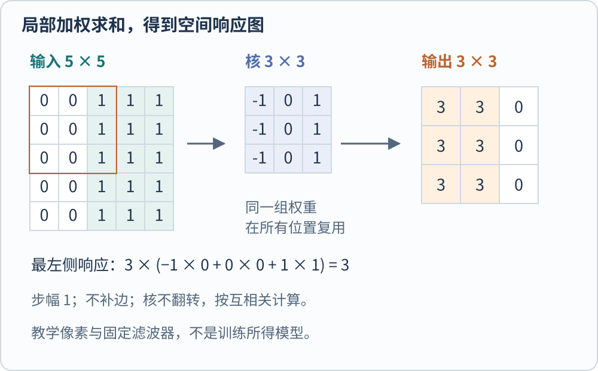
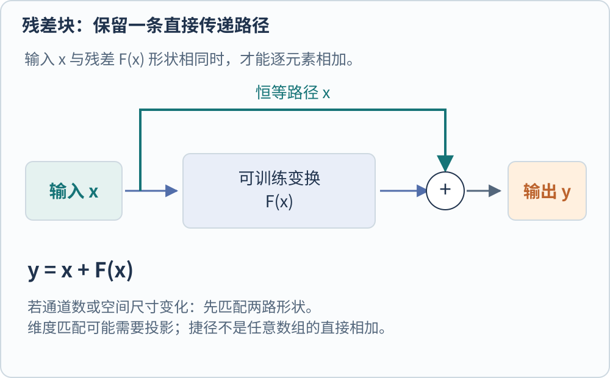

**卷积神经网络用共享的局部运算提取图像特征，再通过训练让这些特征服务于目标任务。** 共享意味着同一组权重会被用在许多空间位置；局部意味着每次运算先看一个有限邻域。两者把图像的空间结构写进模型，而不是把所有像素当成毫无区别的一长串输入。

先看一张只有亮暗分界的教学图。我们希望一个小滤波器在分界附近响应，在亮度均匀的区域不响应。这个例子可以先手算，再理解网络怎样从数据中学到不止一种滤波器。

## 一个卷积核怎样移动

设输入是 $5\times5$ 单通道图像，每一行都是 $(0,0,1,1,1)$。使用下面的 $3\times3$ 核，不补边、步幅为 1。

$$
K=\begin{bmatrix}-1&0&1\\-1&0&1\\-1&0&1\end{bmatrix}.
$$

在最左边的 $3\times3$ 区域中，每行的加权和为 $-1\times0+0\times0+1\times1=1$，三行相加得到 3。向右移动一次仍得到 3；再移动一次，覆盖的都是 1，每行的正负贡献抵消，结果变成 0。因此输出的每行是 $(3,3,0)$。

*图 1　原创可手算算例。橙色表示较强响应，数值按未翻转核的互相关计算；这是深度学习库常用的“卷积”实现约定，并非训练所得的真实滤波器。*

输出大小为 $(5-3)+1=3$。如果补边或步幅改变，大小也会改变；步幅是核每次移动的距离，补边是在输入边界外增加约定值。PyTorch 的 `Conv2d` 文档明确区分输入通道、输出通道、核、步幅和补边，并以互相关定义运算。[@pytorchConv2d214]

真实彩色图像通常有多个输入通道，一个输出通道会组合来自这些通道的局部信息。不同输出通道对应不同的权重组，于是同一个位置可以同时有很多种响应。这些响应构成特征图，各通道的含义由权重和输入共同决定。

## 参数共享为什么重要

若一个小图像特征可能出现在任何位置，逐个位置训练完全独立的识别器会重复学习相似事情。卷积通过共享权重，让相同模式可以在不同位置触发相似运算。对于步幅为 1、边界条件合适的理想情形，输入平移会使响应图相应平移，这叫平移等变。

等变不等于不变。不变要求结果不随平移改变，等变则要求结果以可预测的方式跟着移动。检测任务通常需要保留位置信息；分类任务可以在后面用汇聚等方式降低对位置的敏感性。边界补零和下采样还可能破坏简单的平移对应，因此不能把一个架构标签理解成无条件的数学保证。

参数数量也能直接算清。普通卷积在忽略偏置时，需要 $k^2C_{\mathrm{in}}C_{\mathrm{out}}$ 个权重，其中 $k$ 是正方形核边长，两个 $C$ 分别是输入、输出通道数。比如 $3\times3$、3 个输入通道和 16 个输出通道，只需 $9\times3\times16=432$ 个核权重；同一组权重在所有位置复用，并不会因为输入图像变宽就为每个新位置创建另一套参数。

## 从固定滤波器到监督训练

图 1 的核由人设定，只能检测指定方向的亮度变化。卷积网络通常从初始化权重出发，由损失函数和反向传播更新权重。给出类别标签时，训练会调整中间特征，使最后的类别预测更符合标签。

这并不保证某个通道天然对应“轮子”或“猫耳朵”。可以观察某些响应与图案的关系，但给通道起一个人类名称，需要额外证据。一个在训练分布中有效的特征，也可能恰好依赖背景或水印；训练损失奖励的是预测目标，并不会自行规定人所期待的解释。

AlexNet 的正式论文展示了深层网络与高效 GPU 计算在大规模分类中的结合，正文架构包含五个卷积层与三个全连接层，并使用 ReLU 等设计支持训练。它是重要的规模化实例，而不是卷积思想的起点。[@krizhevskyAlexnet2012]

数据增强、正则化、优化器、训练时长与图像分辨率都可能改变结果。只看到“CNN”两个字，无法推断模型实际看过什么资料、是否过拟合，或者能否在另一个场景中稳定使用。

## 深度增加为什么会遇到优化问题

直觉上，更深的网络可以在旧网络上新增一些“不改变结果”的层，至少不应更难拟合训练数据。但 ResNet 的论文观察到，普通网络继续加深后训练误差反而增大。这是优化上的退化，不能直接解释成测试集上的过拟合。[@heResnet2016]

残差块把目标映射写成

$$
y=x+F(x).
$$

$x$ 是输入，$F$ 是可训练的残差分支，$y$ 是相加后的表示。假如希望这个块大致保留输入，学习较小的 $F(x)$ 就能做到，而不必要求每个新增层重新凑出一个恒等映射。

*图 2　残差块的原创机制图。上下两条路径都到达加法节点，颜色区分恒等传递与可训练变换；图中不把任意维度的数组直接相加。*

两路表示必须形状兼容。输入输出通道或空间分辨率变化时，捷径也需要适当投影或下采样。残差连接改善了训练组织方式，模型仍需合理初始化、优化和训练资料。

## ConvNeXt 提醒我们怎样比较架构

在 Transformer 成为重要视觉骨干后，ConvNeXt 重新检查卷积设计。论文先改变训练配方，再逐步调整宏观结构与局部模块，保留纯卷积路线。仅更新训练设置就能明显改变基线，这意味着“新架构优于旧架构”的差异可能包含训练条件差异。[@liuConvnext2022]

它采用分阶段特征分辨率，并以非重叠卷积构成 patchify 入口。这也说明“把图像分块”不是 Transformer 独有的动作。真正需要比较的是每一阶段怎样混合空间和通道信息，如何改变分辨率，以及这些运算在目标硬件上的代价。

| 比较问题 | 应尽量控制的条件 | 否则容易混入什么 |
| --- | --- | --- |
| 哪种骨干更适合任务 | 训练资料、输入尺寸、预训练与下游协议 | 数据与迁移条件的差异 |
| 哪种实现更快 | 硬件、批量大小、精度、算子实现 | FLOPs 与实际延迟不一致 |
| 是否保留足够细节 | 输出步幅、空间特征、任务头 | 分类成绩掩盖小目标损失 |

对需要高分辨率空间输出的系统，局部运算与多尺度特征有具体价值；对需要全局交互的系统，还要考虑信息需要跨越多少层才能传播。应从输出需求倒推计算组织，而不是先宣布一种模块已经过时。

本页只验证手算例与结构关系，没有训练或比较 CNN、ViT 的实际性能。ResNet 和 ConvNeXt 的机制依据作者预印本，预印本入口分别为 [ResNet](https://arxiv.org/abs/1512.03385) · [Trackback 记录](https://arxiv.org/tb/1512.03385)、[ConvNeXt](https://arxiv.org/abs/2201.03545) · [Trackback 记录](https://arxiv.org/tb/2201.03545)。

[[AI/Vision/index|返回视觉模型专题]]

## 参考文献
