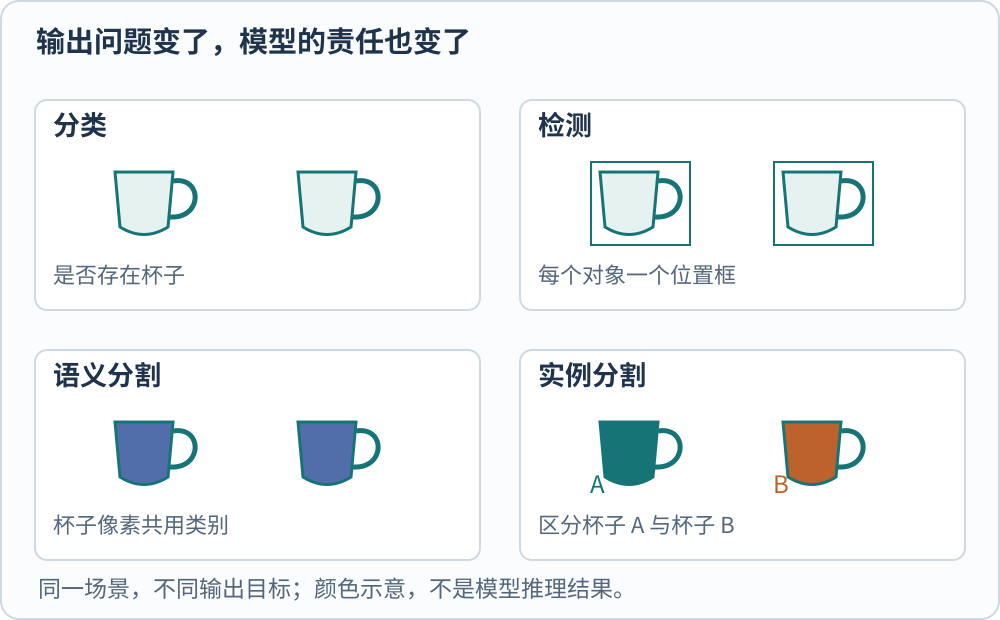
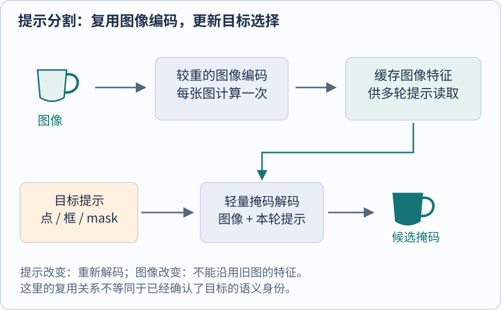

**检测回答对象在哪里，分割进一步回答哪些像素属于目标。** 图中有两个杯子时，分类可以只判断“存在杯子”；检测要输出两个位置；语义分割给杯子像素相同的类别；实例分割还要区分第一个杯子与第二个杯子。

这不是输出格式上的小差异。它决定标注要精细到什么程度、训练损失怎样构造，以及一次错误会怎样影响下游系统。把模型名放回这些问题中，才容易看清不同路线解决了什么。

*图 1　同一教学场景的四种输出。语义分割中的杯子共用颜色，实例分割用不同颜色区分个体；图形为原创，不是模型推理结果。*

## 从候选区域开始，怎样避免重复计算

一种检测思路是先提出可能包含物体的区域，再判断区域类别并修正边界。Faster R-CNN 的区域建议网络 RPN 与后续检测器共享整幅图的卷积特征，避免为每个候选区域从头重复提取图像特征。这里的“两阶段”指候选提出与区域判断的分工，不等于两个完全没有共享的程序。[@renFasterRcnn2015]

另一类思路直接从整图预测位置和类别。原始 YOLO 把检测写成统一的回归与分类问题，使一次网络前向计算直接产生候选检测。它减少了某些流程分拆，但仍然需要训练目标、置信度筛选及具体输出设计。早期 YOLO 的结论不能不加区分地套给后来每个使用该名称的版本。[@redmonYolo2016]

不同位置都可能对同一个杯子产生框。常见处理是非极大值抑制 NMS，保留分数较高的候选，抑制与其高度重叠的其他框。它试图解决重复预测，却也可能在拥挤场景中误伤紧邻目标。于是“怎样规定预测之间的关系”成为检测系统设计的重要问题。

## DETR 把检测看作一个集合

DETR 使用一组可学习的 object queries，生成固定数量的预测槽。每个槽输出对象类别与框，也可以输出“无对象”。训练时，通过二分匹配把真实对象与预测槽一一对应，再计算相应损失；原始方法由此减少了 anchor 设计和 NMS 等手工组件。[@carionDetr2020]

设教学图里有两个杯子、模型有五个预测槽。训练的要求不是让五个槽都回答“杯子”，而是让其中两个分别承担两个真实对象，其余学会无对象。槽的编号并不是数据集中某个固定杯子的身份，也不能直接理解成五个语义类别。

匈牙利匹配用于训练中选择对应关系，推理时并不需要先拿到真实框再匹配。把这两个阶段混在一起，就会误以为模型必须知道答案才能检测。与之相对，匹配计算可以正确完成，也不代表输入分辨率、训练周期和小目标表示已经足够；这些仍是另一组问题。

## 边界框与掩码分别表达什么

一个矩形会包含杯把之间的空白，也可能覆盖背景。若要估计占用面积或沿对象轮廓操作，矩形就不足以表达目标。Mask R-CNN 在区域识别分支旁边增加 mask 分支，并强调输入与输出之间的空间对齐，使每个实例得到自己的像素掩码。[@heMaskRcnn2017]

检测框和掩码都可以计算交并比 IoU，但它们比较的区域不同。定义为

$$
\operatorname{IoU}(A,B)=\frac{|A\cap B|}{|A\cup B|}.
$$

$A,B$ 是两块区域，竖线表示面积或像素数量。设两个教学矩形分别覆盖 $[0,4]\times[0,4]$ 和 $[2,6]\times[0,4]$，各自面积为 16，交集为 8，并集为 24，IoU 为 $1/3$。它衡量区域重合程度，不是“这一定是杯子”的概率。

因此，一个框与参考框很接近，不意味着杯把等细节已分割正确；一张 mask 很漂亮，也不意味着对象类别和数量正确。需要依据实际下游用途，选择框、像素或实例级别的评估对象。

## SAM 把选择目标也变成了输入

提示分割将“分割什么”作为输入的一部分。前景点、背景点、框或已有 mask 可以指向目标；模型根据图像和提示输出掩码。SAM 将图像编码、提示编码和轻量 mask 解码分开，同一图像的较重编码可以复用，不必每次点击都重新计算整个图像表示。[@kirillovSam2023]

一个点落在杯身上，既可能指杯身局部，也可能指整个杯子。原始 SAM 讨论这种歧义，并允许产生多个合理候选。候选掩码的存在不能替代用户或下游系统对目标的确认；“它画出了一个合理区域”和“它理解了指令所说的对象”不是同一个验收条件。

*图 2　提示分割中的计算复用。图像特征只需计算一次，多轮提示重新参与解码；示意的是接口分工，不保证每个版本采用完全相同的缓存策略。*

还要区分论文中讨论的任务范围与公开模型的标准用法。原始 SAM 探索过文本提示，但不能因此把常用的点框分割模型当成已经可靠完成任意文本定位的系统。文本短语指定所有同类对象，是更明确的开放词汇能力要求。

## 从 SAM 2 到 SAM 3，任务又往哪里扩展

SAM 2 将图像提示扩展到视频：当前帧表示结合目标记忆，再预测并更新掩码。这样可以在其他帧继续定位同一个目标，并通过新增提示修正错误。它与逐帧独立分割的差别在于跨帧信息被纳入模型；跟踪一个过去已见目标，仍不等于预测尚未发生的物理变化。[@raviSam22024]

截至本页核验日，SAM 3 官方仓库进一步提供概念提示接口，包含文字或示例指定目标的图像与视频分割；2026 年 3 月发布的 SAM 3.1 更新则引入共享记忆的多对象跟踪方式。这里分别涉及目标指定、分割与跟踪组织，不能都缩成“mask 更精细”。[@metaSam3Repository]

| 系统选择 | 主要输入条件 | 应独立验证的失败 |
| --- | --- | --- |
| 固定类别检测 | 类别定义与训练覆盖 | 漏检、重复框、背景误检 |
| 实例分割 | 位置、类别及像素监督 | 边缘错误、实例粘连 |
| 点框提示分割 | 用户或上游程序给出目标提示 | 提示歧义、区域选择不符 |
| 概念分割与视频跟踪 | 文本/示例以及跨帧目标状态 | 概念混淆、身份切换、遮挡后丢失 |

实际系统中，检测器输出框，再交给提示分割器，是一种可组合方案。它的失败也会沿流程传播：上游漏掉的目标，通常不会仅靠精细化已有框自动补回。判断进步时，应分别检查找到目标、确认类别、分开实例和保持跨帧身份这几个环节。

本文未运行这些模型，不提供跨版本性能排名。论文原文：[Faster R-CNN](https://arxiv.org/abs/1506.01497) · [Trackback](https://arxiv.org/tb/1506.01497)、[YOLO](https://arxiv.org/abs/1506.02640) · [Trackback](https://arxiv.org/tb/1506.02640)、[DETR](https://arxiv.org/abs/2005.12872) · [Trackback](https://arxiv.org/tb/2005.12872)、[Mask R-CNN](https://arxiv.org/abs/1703.06870) · [Trackback](https://arxiv.org/tb/1703.06870)、[SAM](https://arxiv.org/abs/2304.02643) · [Trackback](https://arxiv.org/tb/2304.02643)、[SAM 2](https://arxiv.org/abs/2408.00714) · [Trackback](https://arxiv.org/tb/2408.00714)。

[[AI/Vision/index|返回视觉模型专题]]

## 参考文献
