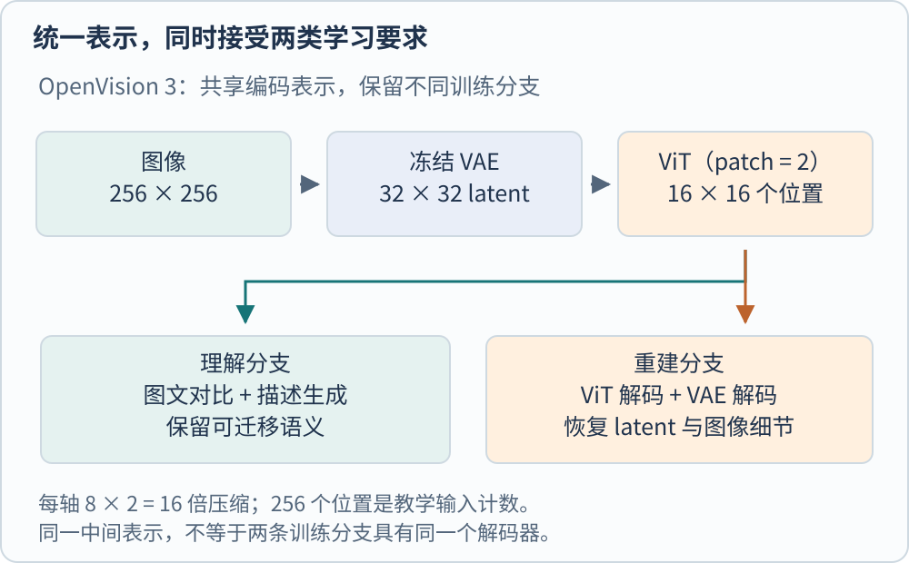
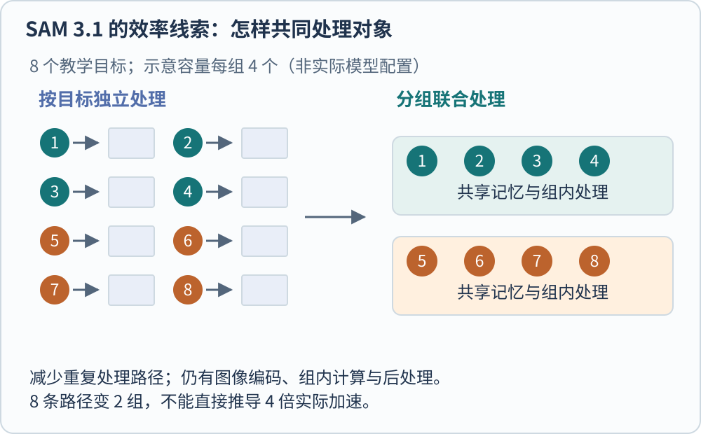

**近期视觉模型在同时解决几类问题：让表示兼顾语义与细节，让记忆能扩展到更多对象，让视觉参与持续推理与执行。** 这些变化分布在编码器、训练目标、连接器和系统流程中。一个新名称可能只对应其中一环，也可能是一整套服务，不能仅按发布日期排成替代链。

本文以截至 2026 年 10 月 26 日可查的公开原始材料为时间截面，选取 2025–2026 年几条有代表性的路线。这里比较机制与交付对象，不给出异构基准的总体排名；模型选择仍需回到输入范围、资源预算和目标任务。

## OpenVision 3 尝试共享理解与重建表示

图文对比学习希望抓住语义，像素重建又需要保留颜色、纹理和局部布局。如果表示为了分类而丢掉这些细节，拿它做生成未必合适；若仅保留便于还原的低层信息，也不一定便于与文字比较。OpenVision 3 将两种要求放到同一个视觉表示的训练中。[@zhangOpenvision32026]

它先用冻结 VAE 把图像每个空间轴缩小 8 倍，再在 latent 上以 $2\times2$ patch 进入 ViT。于是空间上合计缩小 16 倍。对于 $256\times256$ 的教学输入，VAE 网格为 $32\times32$，ViT 入口对应 $16\times16=256$ 个位置。这个计数与原图上 $16\times16$ patch 的位置数相同，但每块内容已经由 VAE 变换，不能因此把两种输入当作同一种像素投影。[@zhangOpenvision32026]

共享表示随后进入两条独立分支。理解侧结合图文对比和描述生成；重建侧恢复 VAE latent，再解码图像，并使用像素、latent 与感知损失。共享的是中间表示，不是把所有训练模块压成一个完全相同的输出头。带噪表示还用于重建侧的训练设计。[@zhangOpenvision32026]

这一工作测试了冻结编码器后在 LLaVA-1.5 理解框架和 RAE 生成框架中的表现。这些设置支持“同一编码表示可以服务两种下游路线”的研究主张，但不证明一个现成的统一编码器已经替代所有视觉语言和图像生成系统。官方 OpenVision 系列仓库提供了对应代码与模型集合入口，使用时要区分系列版本，不把 OpenVision 2 的描述解码器说明直接套给版本 3。[@openvisionRepository]

## 更强整图表示之后，局部信息放在哪里

[[AI/Vision/clip-siglip-and-alignment|SigLIP 2]] 为语义匹配之外的定位和密集特征增加训练目标；[[AI/Vision/self-supervised-visual-learning|DINOv3]] 则用 Gram anchoring 约束 patch 间的相似关系，处理长训练后密集特征退化。这两条路线都在回应整图与局部需求的差异，但监督来源不同，不能简单按一个零样本分类数字评出适用于所有任务的赢家。[@tschannenSiglip22025; @simeoniDinov32025]

Perception Encoder 提供另一种观察角度。其官方研究摘要指出，大规模对比训练得到的通用表示可以藏在中间层，随后通过语言适配和空间适配分别服务多模态语言任务、密集预测。它提醒使用者，模型的最后一层只是一个默认选择，并不是所有任务中最合适的特征出口。这里概括其路线，不把摘要所列成绩扩展为所有分布下的结论。[@metaPerceptionEncoder2025]

这些工作共同改变了视觉塔的选型问题。除了“用哪个模型”，还要确定读取哪层、是否池化、保留哪些空间位置、怎样接任务头，以及后续是否继续训练。换权重而不改读取方式，可能根本没有利用新方法强调的特征。

## SAM 3.1 把多目标跟踪重新组织起来

SAM 3 将概念提示带入检测、分割与跟踪。2026 年 3 月 27 日的 SAM 3.1 更新又引入 Object Multiplex，把目标放进固定容量的组并联合处理，减少按对象独立运行的重复计算。这是对多目标视频流程的改造，既包含共享记忆，也包含推理执行优化。[@metaSam3Repository; @metaSam31Release]

图中用八个目标、每组四个说明分组关系，容量四是教学设定，不代表 SAM 3.1 的实际固定配置。减少重复路径可能提高吞吐，但不能直接用“八次变两次”推导四倍加速；图像编码、组内处理、CPU–GPU 同步和后处理仍有成本。

官方发行说明报告了特定 H100、多目标数量下的效率改善，也明确列出部分视频基准的 mixed results。这种证据更适合支持“改善多目标计算组织”，而不是“全部任务更快且全部指标更高”。新检查点还需匹配更新后的实现，不能只替换一个文件名而保持旧代码不变。[@metaSam31Release]

## 原生多模态怎样组织视觉编码与推理

Qwen3-VL 已经通过动态分辨率视觉塔、空间合并和 DeepStack 将多层特征接入语言层。2026 年的 Qwen3.5 系列官方说明进一步强调视觉语言早融合训练与混合骨干。这里的“原生”主要描述多模态如何参与模型训练与能力形成，并不意味着系统从此没有视觉模块或表示投影。[@baiQwen3Vl2025; @qwenMultimodalRepository]

2026 年 9 月的 Qwen3.8-Omni 报告给出了一个明确例子。它仍有视觉、通用音频和空间音频编码器，输出被投影到 Thinker 的共同表示空间，并加入显式时间信息。Thinker 负责理解、推理和工具使用，实时语音交互则还有相关输出与运行组织。多种输入共享推理过程，与所有输入直接成为同一种原始信号，不是一回事。[@qwen38Omni2026]

它在长视频任务中的一个系统变化是按问题主动取证。相较于一次输入所有抽帧与音轨，模型可以先粗略定位，再调用工具读取相关视听片段，逐轮补充证据。这个过程减少无关片段占用上下文的机会，也引入了检索遗漏风险；若第一轮定位错了，后续精读可能一直围绕错误片段进行。[@qwen38Omni2026]

因此，长上下文窗口、主动取证策略和可靠答案也应分别评价。窗口大只表示能容纳更多 token；真正用到了哪些时间段、是否读到了决定性帧、工具有没有执行，仍需从轨迹与任务结果检查。公开插件可以帮助现有系统获得视听接口，也不能据此推定模型的全部权重、训练数据和服务配置都已经开放。

## 怎样阅读“已发布”和“开源”

| 对象 | 本页的公开入口 | 交付层级 | 使用时仍需区分 |
| --- | --- | --- | --- |
| OpenVision 3 | 论文、OpenVision 系列代码与模型集合 | 共享视觉编码表示 | 版本、预处理与下游框架 |
| DINOv3、SigLIP 2 | 原始论文与各自官方材料 | 预训练表示与适配路线 | 局部/全局用途、标准/NaFlex 等变体 |
| SAM 3.1 | 发行说明、代码和检查点链接 | 多目标视频系统更新 | 新代码匹配、硬件与目标数量 |
| Qwen3.5/3.8 家族 | 官方模型仓库、News 与模型入口 | 多个模型和服务变体 | Max、Flash、Omni 不是同一交付物 |
| Qwen3.8-Omni | 技术报告与视听插件说明 | 原生视听模型及系统流程 | 插件公开不等于全部服务权重公开 |

时间也会改变开放状态。Qwen3.8-Max 的早期公告把权重列为后续计划，当前官方仓库 News 已记录 2026 年 8 月 12 日模型上架。阅读旧文章时，应回到具体模型入口，而不是永久沿用“即将开放”，也不能从同一家族一个检查点可用推出全部变体均可下载。[@qwenMultimodalRepository]

论文证明作者报告了什么，代码说明实现可检查到哪里，权重提供一个可运行起点，完整复现还需要数据、处理器、训练与评价设置。四者不能由仓库名字中一个“Open”代替。许可和模型卡也须按目标用途阅读，本页不作统一商用许可判断。

接下来真正值得追问的，是统一表示是否在同预算下同时保住细节与语义，多目标记忆是否在遮挡和相似实例下稳定，主动取证是否漏掉关键证据。对应的验证方法见 [[AI/Vision/visual-systems-and-evaluation|视觉系统与评价]]。原始入口包括 [OpenVision 3](https://arxiv.org/abs/2601.15369)（[Trackback](https://arxiv.org/tb/2601.15369)）与 [Qwen3.8-Omni](https://arxiv.org/abs/2609.25611)（[Trackback](https://arxiv.org/tb/2609.25611)）。

[SigLIP 2](https://arxiv.org/abs/2502.14786) · [Trackback](https://arxiv.org/tb/2502.14786)；[DINOv3](https://arxiv.org/abs/2508.10104) · [Trackback](https://arxiv.org/tb/2508.10104)；[Qwen3-VL](https://arxiv.org/abs/2511.21631) · [Trackback](https://arxiv.org/tb/2511.21631)。

[[AI/Vision/index|返回视觉模型专题]]

## 参考文献
