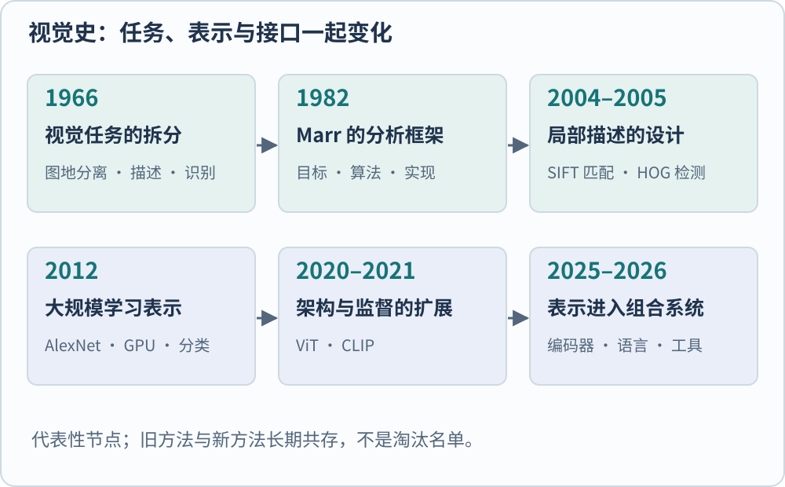

**计算机视觉研究怎样从图像和视频中获得关于对象、结构及事件的信息。** 同一张桌面照片，可以用来判断有没有杯子、寻找杯子的边界、恢复桌面的朝向，也可以让机器人决定从哪里抓取。它们共享像素输入，要求的答案却不同。

这也是视觉史不宜只写成模型排行榜的原因。一个分类器超过另一个分类器，并不意味着它顺便解决了三维重建、动作控制和人的知觉问题。理解这段历史，需要同时追踪任务、表示、训练资料与检验方法。

*图 1　按公开记录整理的代表性节点。箭头表示阅读顺序，不表示后来的方法全面淘汰前者；各阶段内部还存在并行路线。*

## 早期目标已经超出了“认出一个名字”

MIT 档案中的《The Summer Vision Project》由 Seymour Papert 署名，日期为 1966 年 7 月。计划把工作拆为图地分离、区域描述和物体识别。换成桌面照片，就是先把可能属于对象的区域分出来，再描述这些区域，最后尝试与已知对象匹配。档案支持的是这样一个分工计划，而不是流行故事中“一位研究者认为一个暑假就能解决全部视觉”的断言。[@papertSummerVision1966]

这个分解暴露出一个持续存在的问题。阴影可能制造很明显的区域边界，却不对应物体边缘；两个物体挨在一起时，颜色相似又可能让边界消失。系统需要从不充分的二维证据作判断。单张照片里还没有直接写明物体背面或真实尺寸，恢复它们必然依赖额外信息或假设。

早期视觉理论也把“从怎样的图像信息，可以恢复怎样的场景描述”当作核心问题。这条问题线在后来的多视几何、深度估计和三维重建中仍然清楚可见。是否知道一个对象的名称，与是否知道它离相机多远，并没有必然的等价关系。

## Marr 提供的是分析层次，不是一份网络结构

David Marr 的《Vision》于 1982 年出版。MIT Press 对该书的说明强调三个分析层次：计算目标、表示与算法，以及硬件实现。它们分别回答“为什么做这个计算”“用什么表示和步骤做”“由什么物理系统实现”。[@marrVision1982]

仍以恢复桌面方向为例。计算目标可以是估计可供放置物体的平面；算法可以用对应点、透视关系或学习得到的深度来估计；实现可以是相机、处理器及其运行程序。这三个问题可以对应同一个系统，却不能互相替代。知道程序在 GPU 上运行，并没有解释它为什么能估计平面；知道目标是平面估计，也没有规定必须采用哪种网络。

*图 2　Marr 层次的教学对应。三行是对同一系统的不同提问，不是图像必须依次经过的三道处理模块。*

“通用理论”在这里至少有两种含义。一种是通用的提问框架，帮助研究者区分问题与实现；另一种是希望用一条具体处理路径解释大量视觉现象。前者并不直接与 CNN 或 Transformer 竞争，后者则要接受任务范围、图像条件和实验结果的检验。把它们合写成“理论被神经网络击败”，会丢掉重要的层次差别。

## 手工特征把哪些变化提前处理掉了

到了局部特征路线，研究者开始把希望保留或忽略的变化写进算法。SIFT 在不同尺度寻找稳定局部结构，再给它们分配方向并计算描述子；HOG 把局部梯度方向汇总为直方图，并通过块归一化降低局部对比度变化的影响。[@loweSift2004; @dalalHog2005]

两者都把图像变成向量，却服务不同的中间问题。SIFT 适合寻找不同照片中可对应的局部位置；HOG 原始工作的核心案例是结合线性分类器检测行人。这里的“特征”体现了研究者针对尺度、方向和局部形状作出的选择，规定了哪些图像差别被保留、哪些被弱化。

这种设计减少了训练系统需要自行学习的事情，代价是变化范围也被设计者预先限定。能够匹配旋转后的书封面，不等于能够判断两张外观差异很大的椅子属于同一类别。局部几何一致性与语义相似性，从这一阶段起就应分开。

## CNN 改变了特征从哪里来

卷积网络保留了局部连接和参数共享等结构约束，但滤波器的数值由训练来确定。2012 年的 AlexNet 把深层卷积网络、GPU 计算和大规模图像分类训练组合到一起，推动了以学习特征为中心的识别路线。它的贡献不能缩成“那一年才发明了神经网络”。[@krizhevskyAlexnet2012]

这一步改变了模块之间的关系。手工特征流程通常先确定描述子，再训练分类器；端到端训练让分类误差也能影响上游表示。于是，“什么样的图像差别值得保留”可以部分交给数据和训练目标决定。结构先验没有消失，只是与学习的分工变化了。

更深并不自动更好。ResNet 讨论的一个关键现象是，继续堆叠普通层后训练误差反而升高；残差连接通过改变需要学习的映射，改善优化。这属于如何训练表示的具体问题，不能用“网络越大越懂世界”概括。[@heResnet2016]

## ViT 与 CLIP 扩展的是不同的轴

ViT 把图像切成 patch，将局部像素投影为 token，再用 Transformer 处理 token 间的关系。其早期结果与训练资料规模、预训练及迁移设置紧密相关。这是表示计算方式的变化。CLIP 则通过图像与自然语言配对学习，让文字描述成为可复用的监督信号，支持以文本定义的类别进行零样本分类。这是监督与使用接口的变化。[@dosovitskiyVit2021; @radfordClip2021]

因此，“ViT、CLIP、视觉语言模型”不是三个按时间接替的同级架构。CLIP 可以采用 ViT 作为图像编码器；一个生成式视觉语言系统又可以把这类编码器作为视觉塔。判断论文改进了什么，要先问它改的是图像表示、训练目标，还是与语言模型的连接。

| 路线 | 主要交付物 | 不能由名称直接推出的能力 |
| --- | --- | --- |
| 局部特征匹配 | 位置及其描述向量 | 任意语义类别识别 |
| 监督分类网络 | 类别得分、可迁移的中间特征 | 精确边界与三维几何 |
| 图文对齐编码器 | 图像和文本的可比较表示 | 自由生成可靠长答案 |
| 视觉语言系统 | 基于视觉条件生成文本或结构化输出 | 对图中所有细节都已感知正确 |

## 哪些思想失去了主导地位，哪些还在工作

在大规模识别中，逐个手工规定语义特征的路线失去了曾经的中心位置；这不意味着几何关系、局部性、尺度或可解释的中间结果已经无用。ConvNeXt 重新检验卷积的设计空间，表明训练配方和结构细节也会显著影响“卷积与 Transformer”的比较。[@liuConvnext2022]

一个更准确的历史判断是，研究从追求单一固定处理链，逐渐转向可以迁移的表示与可组合系统；同时，对几何一致性、因果理解和实际行动的要求仍未由通用分类成绩自动满足。这是本专题的解释框架，不是某一篇论文已经证明的“统一结论”。

后面的阅读可以沿两个问题继续。一是图像中的哪些变化应该被忽略，哪些必须保留；二是训练目标究竟奖励了什么。前者通向局部特征、卷积和 patch，后者通向监督分类、自监督及图文对齐。先把这两条轴分开，模型名称才会成为有用的线索。

本文的 Marr 部分依据出版社对原著框架的说明，并未逐章核读全书。历史节点用于解释问题与方法的变化，不构成所有视觉研究的完整编年史。

原文入口：[ViT](https://arxiv.org/abs/2010.11929) · [Trackback 记录](https://arxiv.org/tb/2010.11929)，[ResNet](https://arxiv.org/abs/1512.03385) · [Trackback 记录](https://arxiv.org/tb/1512.03385)，[ConvNeXt](https://arxiv.org/abs/2201.03545) · [Trackback 记录](https://arxiv.org/tb/2201.03545)。正式发表信息见下方文献条目。

[[AI/Vision/index|返回视觉模型专题]]

## 参考文献
