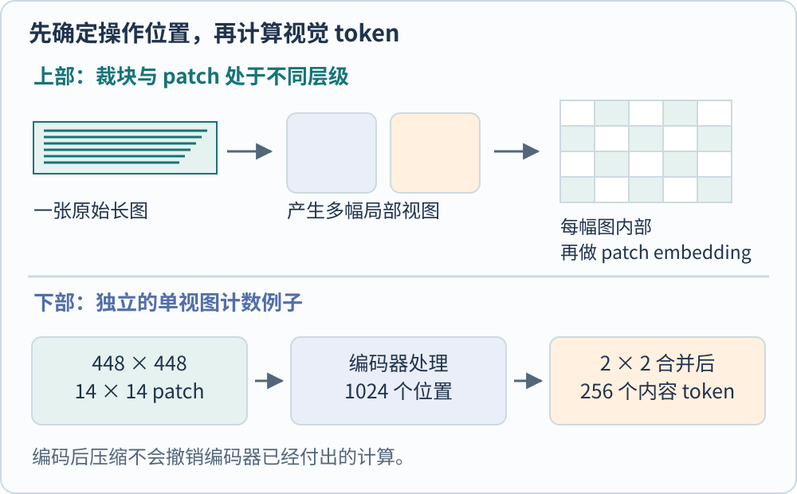
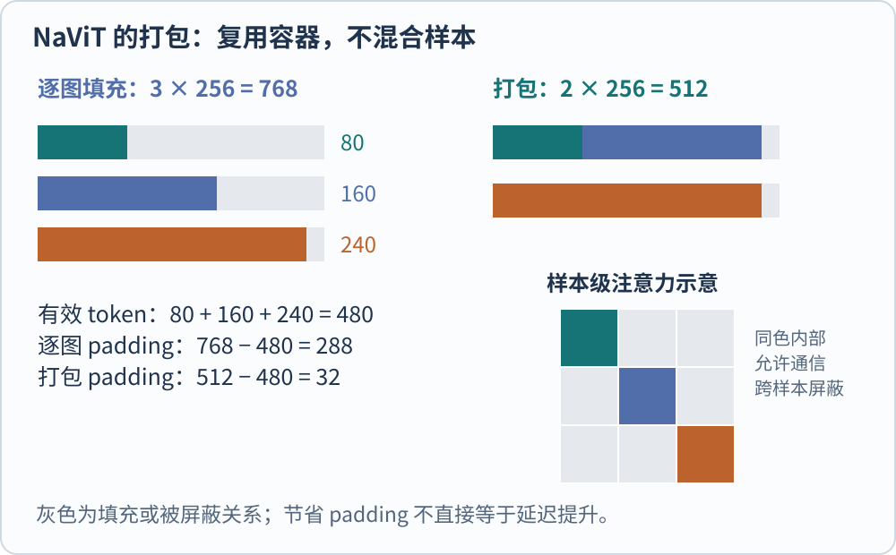

**视觉 token 是图像经过局部切分与编码后，供模型继续处理的向量表示。** 原图像素多、视觉塔看到的 patch 多、语言模型收到的 token 多，是三个相关但不同的数量。高分辨率方案的主要差别，就藏在这三者之间。

考虑一张宽 1600、高 400 的教学长图，里面有很小的文字。直接拉成 224 方图会改变形状；保持比例缩小会让文字更小；切成多张局部图可以保留细节，却会增加计算并割裂局部之间的关系。不存在一个既完全保留信息、又不付额外成本的通用预处理。

## 先分清六种操作

| 操作 | 改变的对象 | 主要风险或代价 |
| --- | --- | --- |
| Resize，缩放 | 原图像素采样网格 | 细节损失或宽高比变化 |
| Padding，补边 | 图像或序列的空白位置 | 若未正确 mask，会引入无效计算或干扰 |
| Crop / tile，裁块 | 提供给视觉塔的图像视图 | 重复计算、边界切断和位置映射 |
| Patch embedding | 一张视图内的局部像素块 | 块大小影响序列长度与局部采样 |
| Packing，打包 | 批次中序列的组织 | 需要区分不同样本的注意力与输出 |
| Token merging | 已有局部表示 | 压缩后可能丢失空间细节 |

这里有一个容易被命名掩盖的区别。预处理代码把 336 像素见方的裁图也叫 patch，ViT 内部又可能把它切成 14 像素见方的 patch。这两个 patch 属于不同层级。讨论参数前应明确，它是裁块边长、视觉塔 patch_size，还是合并后 token 的有效空间步幅。

*图 1　原创处理位置示意。裁块操作产生多幅视图，patch embedding 在每幅视图内部进行；图上相同颜色保持输入与输出的对应，不表示实际特征值。*

## 同一张图，两个模型阶段可能看到不同的长度

先算一个不涉及具体模型的例子。$448\times448$ 图像、$14\times14$ 非重叠 patch，产生 $32\times32=1024$ 个局部位置。若在编码后按相邻 $2\times2$ 合并，空间网格变成 $16\times16$，内容 token 数为 256。

这降低的是合并后阶段处理的长度。视觉编码器已经处理过 1024 个位置，不能把后面的 256 当作其从始至终只计算了 256 个 patch。若合并前有全局注意力，其成本也不能直接按 256 来估计。

Qwen2-VL 提供了一个具体实例：动态分辨率进入修改后的 ViT，使用 2D-RoPE 表示空间位置，随后用 MLP 合并相邻 $2\times2$ token。按论文的 $224\times224$、patch_size 为 14 的例子，先有 256 个 patch，合并为 64 个内容 token，再加起止边界符，进入语言模型的数量为 66。[@wangQwen2Vl2024]

这个 66 属于该模型和该尺寸的设置，不是任意图片的固定价格。处理更宽、更高的图像时，内容 token 数会改变；边界符、视频时间和其他特殊 token 也需要按实际处理器计数。

## 多裁块怎样补细节，又会带来什么

LLaVA-NeXT 的早期发布强调更高输入分辨率和多种宽高比。在其公开预处理实现中，AnyRes 流程选择候选画布、保持比例缩放并补边，再切为局部图；还保留一幅全图缩略视图。局部图提供细节，全图视图提供较完整的布局线索。[@liuLlavaNext2024; @llavaNextPreprocessing]

它并不意味着每个局部块都独立理解完整场景。若一个对象或一句话跨越裁块边界，后续模型仍需结合位置信息与全局上下文。重叠裁块可以减少某些边界问题，但也会重复采样同一区域；去重与合并又成为系统需要处理的事情。

要估计这种方案的代价，可以先数视图，再数每幅视图内的 token。例如自行设定“4 幅局部图加 1 幅全图，每幅产生 576 个内容 token，暂不压缩”，总数就是 $5\times576=2880$。这仅是教学预算，不是所有 LLaVA-NeXT 检查点的最终长度；换了裁图规则、去 padding 或合并方式，数字就会变化。

## NaViT 用打包处理不同形状的图像

NaViT 的 Patch n’ Pack 把不同图像产生的变长 patch 序列放入一个固定长度的计算容器。它不是把两张图在语义上拼成一张图：注意力 mask 阻止不同样本相互读取，输出汇聚也按每张图分别进行。[@dehghaniNavit2023]

设三张教学图分别有 80、160 和 240 个 token，而容器长度为 256。逐图填充时，三个容器共 768 个位置，有效位置只有 480；把前两张放在一个容器、第三张单独放在另一个容器，共 512 个位置，只剩 32 个填充位置。这个例子显示的是 padding 的利用率变化，不是实际吞吐提高了 50%。

*图 2　教学序列的长度与 mask。颜色标记三个样本，灰色为填充；右侧矩阵仅示意样本间禁止通信，不代表完整 token 级矩阵的实际尺寸。*

真正实现中，还需要正确的位置坐标、样本边界和计算内核。如果只是把序列连接起来，却没有正确屏蔽不同图像，训练任务已经被悄悄改变。若实现仍计算大量被 mask 的位置对，打包的实际收益也需要测量，不能只看有效 token 比例。

## NaFlex 不是“完全不缩放”

SigLIP 2 的 NaFlex 变体支持可变宽高比和序列预算。它先在预算内尽量保留宽高比，调整图像尺寸为 patch_size 的倍数，再生成 patch、坐标和 padding mask；学习的位置表被插值到目标网格。原始长宽并非从不改变。[@tschannenSiglip22025]

这个设计把“允许不同形状”与“资源预算有限”放在一起考虑。模型还需要在训练中接触相应分辨率范围。论文区分训练范围内的插值与范围外的外推表现，因此不能因为一个处理器接受更大的尺寸，就宣布细节理解必然改善。

NaViT、NaFlex 和多裁块都可能保留更多长宽结构，但侧重点不同。NaViT 重点改变训练批次组织；NaFlex 重点提供同一编码器的可变形状、可变预算接口；多裁块让一个固定尺寸视觉塔反复查看多个视图。它们可以与其他操作组合，不能只靠“支持任意分辨率”一句话区分。

## 读处理器，比猜模型名字更可靠

实际接入时，至少记录原图大小、缩放和裁图规则、patch_size、合并位置，以及最终有效 token 与特殊 token 的数量。还要保存坐标映射，否则模型在裁块中给出一个框，系统可能把它错误地解释成原图坐标。

这些记录也帮助定位错误。小字在缩放时已经消失，增加语言模型的生成长度不会恢复原始证据；视觉塔有信息而连接器压缩过强，则应检查合并阶段；不同图像意外互相影响，则要查样本 mask 与批次组织。先找到信息在哪一步改变，才有条件讨论“换一个更大模型”是否有用。

本页只进行教学长度计算，不测模型速度或识别精度。原文：[NaViT](https://arxiv.org/abs/2307.06304) · [Trackback](https://arxiv.org/tb/2307.06304)、[Qwen2-VL](https://arxiv.org/abs/2409.12191) · [Trackback](https://arxiv.org/tb/2409.12191)、[SigLIP 2](https://arxiv.org/abs/2502.14786) · [Trackback](https://arxiv.org/tb/2502.14786)。

## 参考文献
