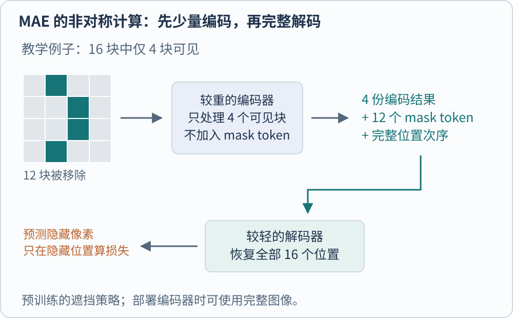
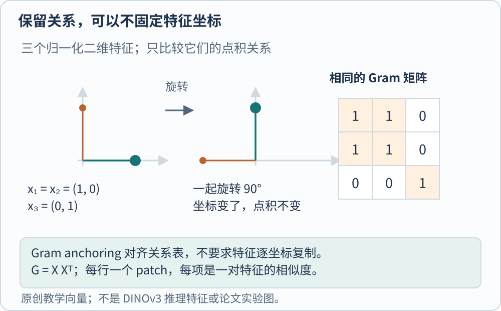

**自监督视觉学习从图像本身构造训练任务，用这些任务学出可迁移的表示。** 人可以不逐张标注“猫”“车”或像素边界，但模型仍有明确目标、损失和数据处理规则。“没有人工类别标签”不会自动等于“没有监督”“没有数据选择”或“什么任务都已经会做”。

同一张照片可以提供不同信号。两次裁剪的图像来自同一原图，这是对应关系；遮去一些 patch 后仍保留原图像素，这是重建目标；另一个缓慢更新的网络对完整图像的输出，则可以成为预测目标。SimCLR、MAE 与 DINO 分别把这些信号组织成不同训练过程。[@chenSimclr2020; @heMae2021; @caronDino2021]

## SimCLR 先规定哪些变化不应改变表示

SimCLR 对同一张图随机生成两个增强视图，经共享编码器和小型 MLP 投影头得到表示。对比损失让这两个视图相互接近，同时与批内其他图像的视图区分。训练结束后，下游任务使用编码器表示，通常不保留原对比投影头。[@chenSimclr2020]

这项设计把一个重要判断放进了增强流程。裁剪、颜色扰动、模糊等变化被当作仍能共享有用信息的视图。原文的增强消融指出，仅靠裁剪可能使模型利用颜色统计辨认配对，加入颜色扰动会改变这个捷径。任务设计因此不能只看损失公式，还要看模型能用什么线索把任务做对。

用四张原图、每张两个视图作计数例子，共有八个表示。固定其中一个，它有一个同图正例、六个其他图像的视图作为负例，自身不参加候选。这里的“不同图”仍不是“语义一定不同”，两张同类照片可能被当作负例。这个计数是原始批内构造的结果，不是所有对比学习都必须如此。[@chenSimclr2020]

增强也有适用范围。例如任务要区分左右方向，却把水平翻转一律当作无关变化，就可能削弱任务需要保留的信息。这是从目标构造得到的设计判断，不能靠“更强增强通常更好”代替检查。

## MAE 把计算集中在可见部分

MAE，即 Masked Autoencoder，随机去掉大量图像块，让模型预测缺失像素。原始方案的关键是非对称编码器与解码器。较重的 ViT 编码器只处理可见块；随后把编码结果与代表缺失位置的 mask token 放回完整顺序，由较轻的解码器恢复图像。[@heMae2021]

图中用 16 块演示遮去 75% 后剩 4 块。对于 $224\times224$ 图像和 $16\times16$ patch，一共有 196 块，同样比例对应 49 块可见、147 块隐藏，这里暂不计 class token。两组数字说明的是长度关系，不代表不同实现会有完全相同的运行时间。

重建损失可以写成

$$
\mathcal L_{\mathrm{rec}}=\frac1{|M|}\sum_{p\in M}\|\hat x_p-x_p\|_2^2.
$$

$M$ 是被遮挡位置的集合，$x_p$ 为该块的像素向量，$\hat x_p$ 为预测。式子省略了块内像素平均等实现常数，重点是只在隐藏位置核对重建；原文还研究了逐块归一化像素目标。位置表示则告诉解码器每个 mask token 应还原到哪里。[@heMae2021]

部署编码器做识别时，可以使用完整图像。预训练的遮挡是制造学习任务和节省编码成本的手段，不是承诺上线后永久扔掉 75% 的输入。另一方面，低像素误差也不直接等于高语义准确率；MAE 的表示价值仍通过下游微调、线性评估等任务检验。

## DINO 的老师由学生的历史产生

DINO 让学生看不同裁块，并匹配教师给出的输出分布。教师参数由学生参数的指数移动平均更新，简称 EMA。若 $\theta_t$、$\theta_s$ 分别是教师、学生参数，$0\leq\lambda<1$ 为平滑系数，更新为

$$
\theta_t\leftarrow\lambda\theta_t+(1-\lambda)\theta_s.
$$

例如只看某一个标量参数，旧教师是 2、新学生是 4，取教学系数 $\lambda=0.9$，更新后教师为 2.2。教师提供较平缓的目标，学生通过梯度更新；教师分支则停止梯度，不沿同一损失一起反向修改。原始 DINO 还对教师输出做中心化与锐化，防止所有图像输出相同分布的表示坍缩。不能把 EMA 单独当作防坍缩保证。[@caronDino2021]

教师输出的维数也不等于人工命名类别数。模型在一个学习得到的输出空间里比较分布，并没有因此获得每一维对应“杯子”“汽车”的语义词典。它可能产生有用的局部结构，具体能否支持分割，仍须另外设置评价。

DINOv2 进一步把图像级 DINO 目标与 patch 级 iBOT 目标结合，并重视大规模数据去重、检索和整理。iBOT 让被遮挡位置预测教师特征，这与 MAE 预测像素不是同一种重建对象。两者都可以叫 masked prediction，但“预测什么”会改变损失要求保留的信息。[@oquabDinov22023]

## DINOv3 为什么约束特征之间的关系

DINOv3 报告了一个值得单独记住的现象。继续训练时，图像级分类表现可以提高，密集预测表现却下降；patch 特征逐渐失去局部一致性。整图好不好辨认，与每个位置是否还提供可靠细节，并非同一个问题。其 Gram anchoring 针对的是后者。[@simeoniDinov32025]

设一张图有 $P$ 个 patch，每个归一化特征为 $d$ 维。把它们按行叠成 $X\in\mathbb R^{P\times d}$，Gram 矩阵为 $G=XX^\top$，大小是 $P\times P$。它记录每对 patch 的余弦相似度。DINOv3 让学生的这张关系表接近一个保留较好局部结构的 Gram 教师，而不要求每个特征坐标原样不动。[@simeoniDinov32025]

例如三个特征设为 $(1,0),(1,0),(0,1)$。前两个点积为 1，第三个与前两者点积为 0，对角线均为 1。把三者一起旋转 90 度，坐标全变了，关系表仍相同。这个可手算例子说明了“保留关系”给表示留下的自由度，不是实际模型学出的三个特征。

论文中的损失为

$$
\mathcal L_{\mathrm{Gram}}=\|X_SX_S^\top-X_GX_G^\top\|_F^2.
$$

$S$、$G$ 表示学生与 Gram 教师，$\|\cdot\|_F^2$ 为矩阵各项平方之和。教师从具有良好密集特征的较早状态取得，并在精修中定期刷新；高分辨率教师特征经过平滑降采样后还能提供关系目标。这与把早期模型永久冻结、复制全部特征，都是不同操作。[@simeoniDinov32025]

## 选表示时，把下游问题带回来

| 下游更需要什么 | 应重点检查什么 | 单一成绩遗漏什么 |
| --- | --- | --- |
| 整图检索、分类 | 全局向量与目标数据上的可分性 | 不一定保留小物体与边界 |
| 分割、深度等密集任务 | patch 表示、空间分辨率与任务头 | 全局分类高分不能替代密集评价 |
| 通过文字找图或接入语言模型 | 文本关联或另外训练的语言接口 | 纯视觉预训练不自动带来词语对齐 |

线性探测固定编码器，只训练线性头；完整微调则允许编码器一起变化。报告二者时要区分训练标签、数据划分和调整预算。漂亮的特征投影图只提供辅助观察，可对照 [[DL/dimensionality-reduction-visualization|降维可视化]] 理解证据范围。

接下来可以比较 [[AI/Vision/clip-siglip-and-alignment|图文监督]]，或看 [[AI/Vision/vision-towers-and-connectors|视觉表示怎样送入语言模型]]。本页仅解释论文机制与教学计算，不声称已重跑预训练或得到跨论文统一排名。[MAE 原文](https://arxiv.org/abs/2111.06377)（[Trackback 记录](https://arxiv.org/tb/2111.06377)）、[DINO 原文](https://arxiv.org/abs/2104.14294)（[Trackback 记录](https://arxiv.org/tb/2104.14294)）、[DINOv3 原文](https://arxiv.org/abs/2508.10104)（[Trackback 记录](https://arxiv.org/tb/2508.10104)）可作为继续阅读入口。

[[AI/Vision/index|返回视觉模型专题]]

## 参考文献
