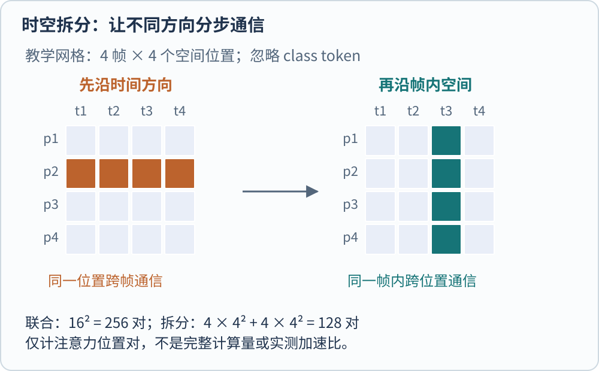
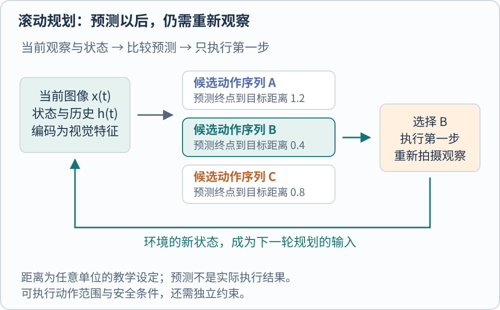

**视频模型要处理变化的顺序，世界模型还要描述状态怎样演化。** 认出一段视频里有杯子、跟踪其中某只杯子，以及预测执行动作后杯子会到哪里，是三个不同任务。它们可以共享视觉编码器，却不能仅凭“看过很多视频”相互替代。

一个简单反例就能说明时间的重要性。将“手拿起杯子”的帧倒放，会变成“手放下杯子”。逐帧对象清单相同，动作含义却变了。只有整图特征而没有时序组织的汇总，可能保留“手”和“杯子”，同时丢掉决定动作的方向。

## 把二维网格扩展为时空网格

若抽取 $T$ 帧，每帧有 $N$ 个 patch，直接展开会得到 $TN$ 个位置，还需表示它们来自哪一帧和哪个空间位置。TimeSformer 将帧内 patch 接入 Transformer，并比较不同的时空注意力组织。其 divided attention 在一个块内先让同一空间位置跨帧通信，再让同一帧内的空间位置通信。[@bertasiusTimesformer2021]

用图中 $T=N=4$ 的教学设定计数，不考虑 class token、投影与 MLP。完全联合注意力有 $(TN)^2=256$ 个有序位置对；拆分后的两部分分别有 $NT^2$、$TN^2$ 个，合计 128。一般写作

$$
\text{联合配对数}\sim T^2N^2,\qquad
\text{拆分配对数}\sim NT^2+TN^2.
$$

这只是比较注意力分数的组织规模，不是实测 FLOPs 或两倍端到端加速。分解后要做两段计算，Q/K/V 投影与中间表示也有成本。同一像素位置跨帧交流，还不等于已经追踪到了同一个物体；镜头和对象都可以运动，模型仍需学习这些变化。

另一个省长度的办法是入口就做时空块。VideoMAE 原始实现将 $2\times16\times16$ 的视频小立方体编码成一个 token，即同时聚合两帧和一块空间区域。16 帧、每帧 $224\times224$ 的教学输入因此对应 $8\times14\times14=1568$ 个时空块，不能再按 16 份独立二维网格计数。[@tongVideomae2022]

## 视频遮挡要防止从邻帧抄答案

[[AI/Vision/self-supervised-visual-learning|图像 MAE]] 用缺失像素构造任务。视频的相邻帧很相似，如果某块只在这一帧被挡住，下一帧却完整可见，重建可能退化为利用时间冗余复制内容。VideoMAE 的 tube masking 让不同时间共享空间遮挡图，整条时间方向的同位区域一起隐藏，并研究较高遮挡比例。[@tongVideomae2022]

这种设计改变了模型能利用的线索。它没有保证所有对象运动都会被理解，也不表示在推理时必须保留相同的高遮挡率。遮挡学习任务、入口时空降采样和部署抽帧是三种操作；前者定义训练目标，后两者改变实际送入模型的信息。

抽帧还有信息边界。假设动作只持续十分之一秒，而系统每秒取一帧，它可能完全错过动作。提高分辨率不能补回未采到的时间片段。对长视频做稀疏浏览后再对相关片段密集读取，是一种系统选择；它需要保存时间戳和检索路径，不能只根据最终摘要推断已经观察了全过程。

## SAM 的记忆保存目标线索，不是预测物理未来

SAM 2 把提示分割扩展到视频，通过记忆读取已有帧与目标信息，帮助当前帧保持对象身份。早先某帧中的提示、掩码和对象特征，会影响后续帧怎样分割。遮挡、相似对象和错误掩码仍可能导致身份漂移，因此新的提示可以承担纠正作用。[@raviSam22024]

这种记忆回答的是“刚才选中的对象，现在在哪里”。它与语言模型保存对话文本、或世界模型预测动作后状态，都不是同一种记忆。SAM 3.1 的 Object Multiplex 又改变了多目标记忆的计算组织，采用共享方式联合处理目标；这是跟踪效率路线，不能据此推出模型已经能模拟碰撞、摩擦和因果干预。[@metaSam31Release]

## V-JEPA 2 先预测表示，再学习动作条件

V-JEPA 2 的基础预训练从遮挡视频预测教师网络的特征，目标在潜在表示空间，而非逐像素画出视频。编码器与预测器共同训练，教师由编码器参数的移动平均形成。这个阶段没有机器人动作输入，学到的是可用于理解和预测的视觉表示。[@assranVjepa22025]

动作条件版本 V-JEPA 2-AC 则需要额外的机器人交互数据。论文冻结视觉编码器，结合历史特征、末端执行器状态和动作，训练下一时刻的特征预测器。所谓“无标签机器人视频”不表示没有状态信号：原文使用了末端位置、方向与夹爪状态，并由相邻状态变化构造动作，只是不依赖任务名称、成功标签和奖励标注。[@assranVjepa22025]

规划时，系统将目标图像也编码成特征，寻找使预测结果接近目标的动作序列。抽象地说，令 $h_t$ 表示当前可用的观测与状态历史，$a_{1:H}$ 表示未来 $H$ 步动作，$\hat z_H(h_t,a_{1:H})$ 为预测终点表示，$z_g$ 为目标表示，可以最小化

$$
a_{1:H}^{*}=\arg\min_{a_{1:H}}\|\hat z_H(h_t,a_{1:H})-z_g\|_1.
$$

这是一种说明数据关系的简写，实际控制还需动作范围、采样优化与环境约束。原论文执行所选序列的第一步，然后重新观察并规划，而不是把整条想象轨迹不加检查地执行到底。图中距离数值为教学设定，没有机器人或模型实测。[@assranVjepa22025]

## 从“像未来”到“可用于控制”还有距离

视觉上流畅的视频，不保证动作可执行；潜在距离小，也不必然表示所有安全条件满足。动作模型必须把控制坐标与相机观察联系起来。V-JEPA 2-AC 原文指出了对相机位置的敏感性，并在实验中选择合适视角；这限制了把其结果直接推广到任意相机与机器人。[@assranVjepa22025]

普通视频分类还可以使用整个片段的信息，在线控制只能使用当前与过去的观测。比较两类系统时，应核对有没有读取未来帧，目标是类别、目标掩码、下一状态还是可执行动作。它们的成绩不能压成一个统一的“理解世界”分数。

若关心视频如何接入语言模型，可继续读 [[AI/Vision/vision-towers-and-connectors|视觉塔与连接器]]；若关心动作输出之后怎样判断任务完成，可看 [[AI/Vision/visual-systems-and-evaluation|视觉系统与评价]]。原始入口为 [TimeSformer](https://arxiv.org/abs/2102.05095)（[Trackback](https://arxiv.org/tb/2102.05095)）、[VideoMAE](https://arxiv.org/abs/2203.12602)（[Trackback](https://arxiv.org/tb/2203.12602)）和 [V-JEPA 2](https://arxiv.org/abs/2506.09985)（[Trackback](https://arxiv.org/tb/2506.09985)）。

[[AI/Vision/index|返回视觉模型专题]]

## 参考文献
