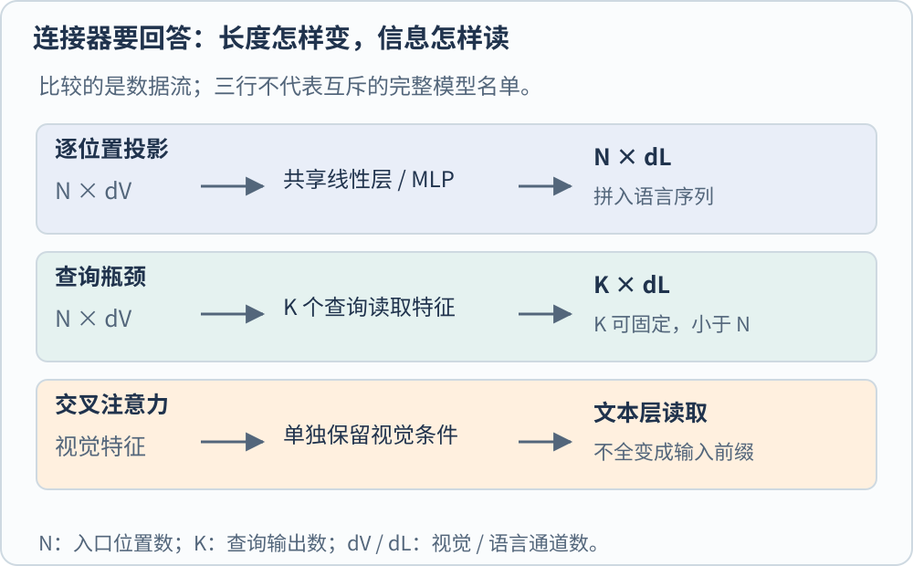
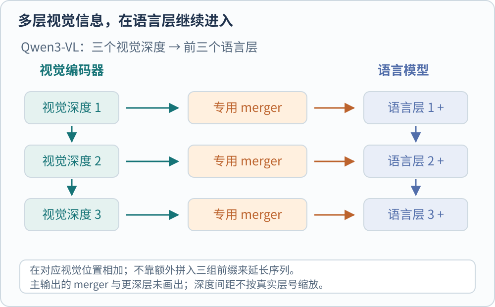

**视觉塔是系统中负责把图像转换成视觉特征的编码模块，连接器再把这些特征变成语言模型能使用的条件。** “塔”描述模块在系统中的结构位置，具体编码器可以基于 ViT 或卷积网络。完整的视觉语言模型还包括文本处理、语言模型、训练任务及输出规则；视觉塔承担其中的图像编码环节。

[[AI/Vision/clip-siglip-and-alignment|CLIP]] 能在共同的表示空间中比较图文相似度。接入语言模型时，还需要把视觉特征映射到语言端使用的维度，并通过训练建立可用于文本生成的对应关系。连接器负责这项衔接。原始 LLaVA、BLIP-2 与 Flamingo 分别给出了几条接入路线。[@liuLlava2023; @liBlip22023; @alayracFlamingo2022]

## 先分清整图向量与空间特征

视觉编码器可以输出整图摘要，也可以保留按空间位置排列的网格特征。若要回答图中小字或局部对象问题，过早把所有位置池化成一个向量，就会把空间细节压进单一摘要。LLaVA 使用 CLIP 的网格特征，BLIP-2 的查询也读取未压成单个整图向量的视觉特征。[@liuLlava2023; @liBlip22023]

用一个教学形状贯穿后文。假设编码器输出 256 个位置，每个 1024 维，记作 $H_v\in\mathbb R^{256\times1024}$。目标语言模型的隐藏维数为 4096。接口需要同时确定两个独立维度，送入语言模型的位置数量，以及每个位置的特征维数。

## 投影与拼接保留序列，转换通道

最直接的连接器为每个视觉位置应用同一个可训练投影。按行向量约定，令 $W\in\mathbb R^{1024\times4096}$，则

$$
Z_v=H_vW\in\mathbb R^{256\times4096}.
$$

不计偏置，矩阵有 $1024\times4096=4194304$ 个参数。投影改变通道数，保留原来的 256 个位置。得到的连续视觉嵌入可以和文本嵌入一起组成语言模型的输入序列。

本节以原始 LLaVA 为例，它用线性投影连接 CLIP 视觉编码器与 Vicuna。其训练先让连接部分学习视觉与语言的对应关系，再通过视觉指令数据训练回答行为。投影使两侧的数组维数兼容，训练则让投影后的特征能够被语言模型用于生成回答。[@liuLlava2023]

拼接路线的成本也容易追踪。若文本有 $L$ 个位置、视觉有 $N$ 个位置，语言端处理的是与 $L+N$ 相关的序列。以完整稠密自注意力为参照，其分数规模随 $(L+N)^2$ 增长。端到端延迟还受因果 mask、分组注意力和内存优化等实现条件影响，需要结合具体系统测量。

## BLIP-2 用少量查询提取视觉信息

BLIP-2 在冻结的视觉编码器与语言模型之间加入 Q-Former。它维护一组可学习的查询向量，通过交叉注意力读取图像特征，并通过自注意力让查询之间交换信息。原文使用 32 个查询，每个 768 维，得到 $32\times768$ 的输出，随后将这些输出投影到目标 LLM 的输入维数。[@liBlip22023]

这 32 个查询向量作为模型参数参与训练。每次处理图像时，它们结合当前图像的特征，形成固定数量的输出向量，构成传递给语言模型的信息瓶颈。输入位置增加时，Q-Former 读取图像特征的计算量仍会变化；后续送入语言模型的表示长度则由查询数量决定。

BLIP-2 分两阶段预训练。第一阶段使用图文对比、图文匹配和基于图像的文本生成等目标，学习从冻结视觉塔提取与文字相关的信息。第二阶段把查询输出投影成软视觉提示，与文本嵌入一起送给冻结 LLM，训练视觉到语言的生成。两个阶段分别建立视觉与文字的表示关系，以及视觉表示对语言生成的条件作用。[@liBlip22023]

固定瓶颈有实际取舍。一个大场景里的许多小字、对象和位置，可能难以同时通过少量向量传递。增加查询数量会改变表示容量与后续处理成本，其对目标任务的效果需要在相同训练条件下检验。评价这种压缩时，应同时观察输出长度、计算成本与任务所需信息的保留情况。

## Flamingo 让语言层读取外部视觉条件

Flamingo 先用视觉编码器得到空间或时空特征，再用 Perceiver Resampler 转成固定数量的视觉表示。随后，新增的带门控交叉注意力层插入冻结语言层之间：文本隐藏状态提供 Query，视觉表示提供被读取的条件。原有语言参数保持冻结，新接口学习怎样使用视觉信息。[@alayracFlamingo2022]

与前文 LLaVA 的视觉嵌入前缀拼接相比，Flamingo 把视觉条件保存在独立的特征张量中，让文本隐藏状态在指定层通过交叉注意力读取。图中的“外置视觉记忆”指这组供注意力访问的特征张量。处理多图或交错图文时，注意力 mask 还规定每段文字可以访问哪些图像，使文本与相应的图像条件保持对应。[@alayracFlamingo2022]

Flamingo 的训练更新新增的重采样器、交叉注意力等模块，保留预训练视觉编码器与原语言模型的参数。推理时，系统仍需执行图像编码、视觉重采样和语言层读取等计算。参数是否更新描述训练状态；一次输入需要多少计算描述运行成本。[@alayracFlamingo2022]

## Qwen3-VL 在多个深度继续注入视觉

Qwen3-VL 利用视觉塔多个深度的特征。其视觉塔从 SigLIP 2 初始化，并继续做动态分辨率训练；主连接器把相邻 $2\times2$ 特征合并后映射到语言维数。除此之外，DeepStack 分支抽取三个不同深度的视觉特征，经专用 merger 后，加到前三个语言层中对应的视觉位置隐藏状态。[@baiQwen3Vl2025]

这里同时发生了空间合并和跨深度注入。前者改变位置数，后者通过已有序列中的视觉位置增加可访问的层级信息。Transformers 实现的 `_deepstack_process` 使用 `visual_pos_masks` 选择视觉位置，再与该分支的特征相加，这也给出了可检查的对应关系。[@qwen3VlTransformersImplementation]

这里介绍的是 Qwen3-VL 的具体实现。增加视觉分支会带来特征提取与连接计算；评估多层注入时，需要同时考虑这些开销与目标任务的实际效果。[@baiQwen3Vl2025]

视觉塔选哪一层、是否做池化、保留多少位置，会共同改变连接器拿到的内容。[[AI/Vision/self-supervised-visual-learning|DINOv3 对全局与密集特征的区分]] 展示了整图表示与局部空间表示的不同评价需求。选择视觉特征时，应根据整图识别、局部定位或文字读取等实际任务，检验所选层与空间处理方式。

## 沿数据流检查完整接口

阅读或部署一个多模态模型时，可以沿一次输入逐项追踪完整接口。图像怎样缩放和裁块，输出哪个层、多少位置，连接后维数是否兼容，图像位置如何对应文本，哪些参数接受过什么训练，答案需要核查时有哪些输入证据可回看，这些都会影响系统行为。

例如一张长图被拆成四块后，跨块的左右关系需要由位置或排列规则表达。入口保留的文字与空间信息，决定了后续模块能够使用哪些视觉证据。可先结合 [[AI/Vision/patches-resolution-and-tokens|patch 与分辨率]] 阅读，随后再区分生成答案与真正调用工具执行动作的系统边界。

本页比较的是数据流和训练接口，不对不同论文的异构基准做总体排名。[BLIP-2 原文](https://arxiv.org/abs/2301.12597)（[Trackback 记录](https://arxiv.org/tb/2301.12597)）、[Flamingo 原文](https://arxiv.org/abs/2204.14198)（[Trackback 记录](https://arxiv.org/tb/2204.14198)）和 [Qwen3-VL 报告](https://arxiv.org/abs/2511.21631)（[Trackback 记录](https://arxiv.org/tb/2511.21631)）提供相应机制的原始说明。

[LLaVA](https://arxiv.org/abs/2304.08485) · [Trackback](https://arxiv.org/tb/2304.08485)。

[[AI/Vision/index|返回视觉模型专题]]

## 参考文献
