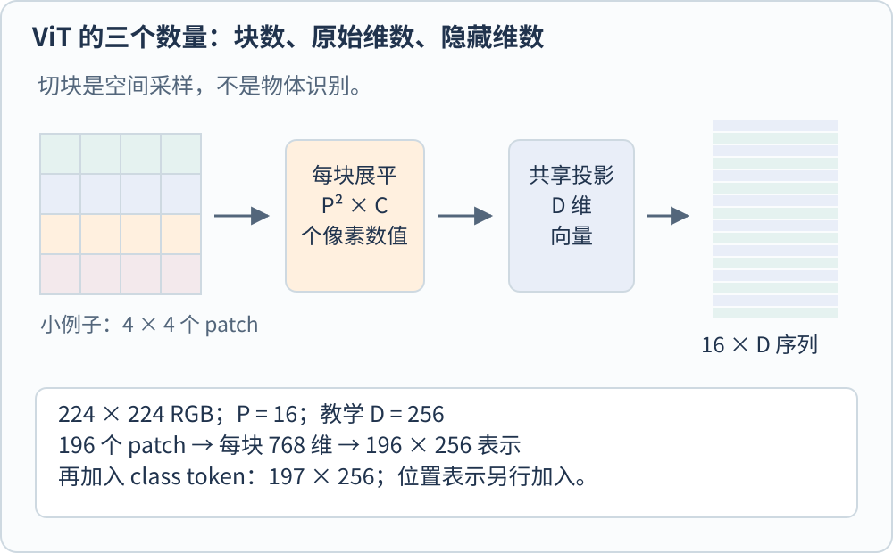
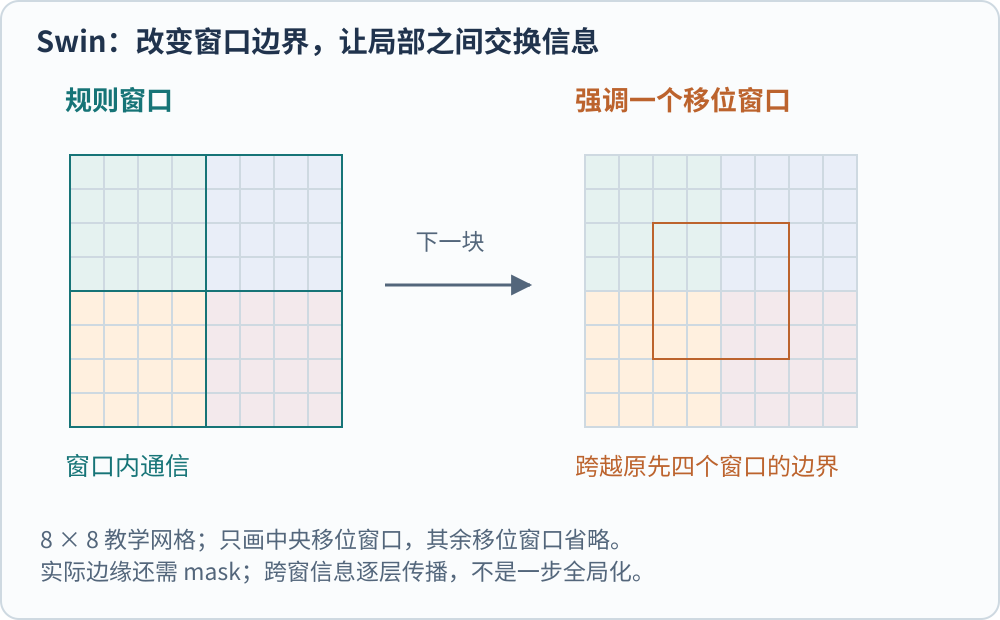

**Vision Transformer（ViT）把图像组织为局部块的向量序列，再通过注意力交换这些位置的信息。** 图像并没有在数学上变成语言：视觉 token 是一块像素的表示，不是天然对应一个单词，也不保证恰好覆盖一个物体。

在一张杯子照片中，杯把可能横跨几个 patch；一个 patch 也可能同时含杯沿和背景。模型必须在后续计算中组合这些局部证据，而不是依靠切块本身得到语义单元。

## 先把三个维度分开

图像高度为 $H$、宽度为 $W$、通道数为 $C$，patch 边长为 $P$。忽略不能整除的边界处理时，patch 数为

$$
N=\frac{H}{P}\frac{W}{P}.
$$

每个 patch 展平后有 $P^2C$ 个数，再用可学习投影映射到隐藏维度 $D$。$N$ 是序列长度，$D$ 是每个位置的表示宽度，$P^2C$ 是投影前的原始维数，三者不能混用。[@dosovitskiyVit2021]

用一组独立教学设置计算：$H=W=224$、$C=3$、$P=16$、$D=256$。图像产生 $14\times14=196$ 个 patch；每块展平为 768 维；投影矩阵把 768 维映射到 256 维，得到 $196\times256$ 的表示。这里的 256 是教学选择，不是所有 ViT 的统一配置。

*图 1　图中用 4×4 网格表示一个小型教学例子，文字同时标明 224 方图的计算。网格不是按物体边界切分，所有 patch 使用同一投影规则。*

原始分类用法还加入一个可学习的 class token，以上例为 $197\times256$。它从其他位置收集信息，最后被分类头读取。也有实现使用池化或保留全部 token；class token 是一种输出组织方式，不是 Transformer 唯一允许的表示。Google 官方实现可看到这些分支，以及用同核同步幅卷积实现 patch 投影的等价写法。[@googleVitImplementation]

## 切成序列以后，位置没有自动保留下来

如果只给模型一组局部向量，模型还需要知道它们来自图像哪里。原始 ViT 在 patch 表示上加入可学习位置嵌入，让内容与位置共同进入编码器。空间排列关系的使用，不能只靠“第一个放进数组”的程序顺序来假定。

位置表也会影响不同分辨率下的使用。训练时的网格和推理时的网格不一样，需要相应适配位置表示；能够生成一个新网格，并不保证模型已经在这些尺寸上学会稳定工作。更广泛的机制可对照 [[AI/LLM/transformer-positional-encoding|Transformer 位置编码]]。

## 注意力怎样让远处的信息发生联系

每个位置的表示通过线性投影得到 Query、Key 和 Value。Query 与其他位置的 Key 比较，形成匹配分数；分数经过缩放、可选 mask 和 Softmax 后成为汇总权重，再用它们加权 Value。常见单头写法是

$$
\operatorname{Attention}(Q,K,V)
=\operatorname{softmax}\left(\frac{QK^{\mathsf T}}{\sqrt{d_k}}\right)V.
$$

$d_k$ 是一个注意力头中 Query 和 Key 的维数。Softmax 通常沿被查询的位置归一化，所以这里的权重说明一次信息汇总怎样分配，不是“这个 patch 属于杯子”的类别概率。官方计算接口的等价实现也明确保留了分数、mask 与 Value 汇总这几个步骤。[@pytorchSdpa214]

多头注意力把匹配组织在多个投影空间中。若教学设置中总宽度为 256、使用 4 个等宽头，每个头可取 64 维。合并各头后再作输出投影，序列仍是原来的 197 个位置，而不是突然变成 788 个 patch。头的数量、位置的数量与物体的数量是三个不同概念；四个头并不预先承诺分别负责四类对象。

全局注意力允许一个局部位置在单层中访问所有其他位置，但是否学会使用这些关系，取决于权重与训练目标。后面的多层感知机 MLP 进一步变换每个位置的通道表示；归一化与残差连接组织这些运算。不能把整个 ViT 的能力都归功于一张注意力热图。[@googleVitImplementation]

## 分辨率为什么很快变成成本问题

在上述 patch 数公式中，高和宽都翻倍，$N$ 会变成原来的四倍。若显式计算全局两两注意力，分数项规模与 $N^2$ 成正比，就变成十六倍。

继续用 $P=16$，将方图边长从 224 改成 448，patch 数从 196 变为 784。不计 class token 的注意力位置对数量，从 $196^2=38416$ 变为 $784^2=614656$。这说明的是一个计算项的增长，**不是整网推理延迟一定变成十六倍**。投影、MLP、内存访问和实现都会影响总耗时。

内存高效的注意力实现可以减少中间矩阵的实际存储，不等于从数学上取消所有位置对的计算。因此，比较不同模型时需要同时写清分辨率、序列长度、隐藏维度及实现条件，而不是只比较参数量。

## DeiT 改进的是训练，不只是一种新切法

原始 ViT 体现了大规模预训练的作用。DeiT 则研究更数据高效的训练方式，并引入蒸馏 token，让学生模型从教师模型获得训练信号，教师可以是卷积网络。[@touvronDeit2021]

这给出一个很有用的反例：学生模型使用 Transformer，不代表训练中不能利用卷积网络的知识。架构形式、训练资料和监督来源是不同的选择。看到某个 ViT 在较少资料上工作得更好，需要检查优化与增强策略，不能直接归因于 patch 数量变化。

## Swin 把局部窗口和多尺度结构带回来

Swin 在局部窗口内计算注意力，并在相邻块之间移动窗口边界，让原先分属不同窗口的位置逐步交换信息；再通过 patch merging 降低网格分辨率，形成层次化特征。它针对的是高分辨率和密集预测需要，而不只是把分类头换一个名字。[@liuSwin2021]

*图 2　8×8 教学网格中，左图是 4×4 的规则窗口，右图只强调一个跨越原边界的移位窗口。边缘 mask 与批量实现未画出；一次位移不等于每个位置立即拥有全局感受野。*

固定窗口大小后，窗口内位置对数量随整幅图 token 数近似线性增长。与此同时，窗口限制了单步通信范围，跨窗口关系需要后续层传播。patch merging 又改变了空间细节与通道宽度。这些是效率和表示之间的具体交换，不能用“局部一定弱于全局”或“线性复杂度一定更快”代替分析。

| 方案 | 主要改变 | 阅读时先检查什么 |
| --- | --- | --- |
| 原始 ViT | patch 序列与全局编码 | 预训练规模、位置和输出表示 |
| DeiT | 数据效率与蒸馏训练 | 教师信号、增强和训练协议 |
| Swin | 窗口、跨窗联系与层次表示 | 窗口尺寸、合并位置及空间输出 |

本页算例只核对形状与计算规模，不评价三者的总体性能。原文：[ViT](https://arxiv.org/abs/2010.11929) · [Trackback](https://arxiv.org/tb/2010.11929)、[Swin](https://arxiv.org/abs/2103.14030) · [Trackback](https://arxiv.org/tb/2103.14030)。

## 参考文献
