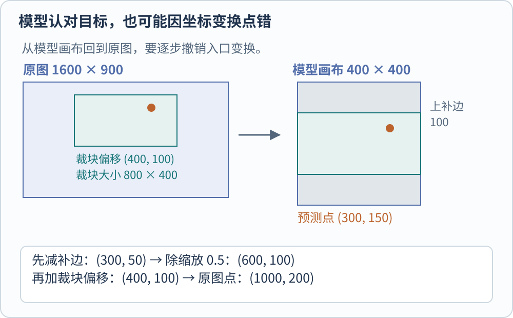
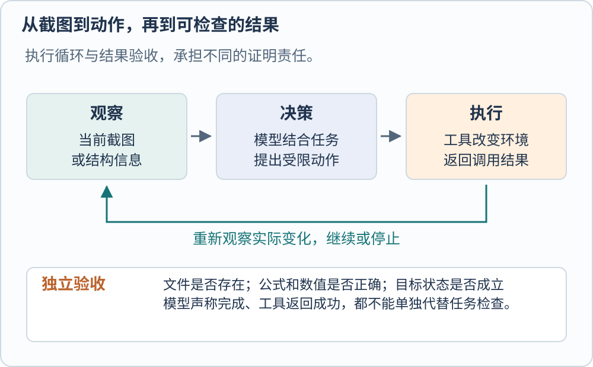

**视觉模型进入系统后，责任从产生一个表示或答案，扩展到让输入、输出与外部任务准确对应。** 一张图怎样被读取，是否裁掉了内容，预测坐标属于哪个画布，动作有没有执行成功，都会影响最终结果。仅替换视觉塔，无法自动修复这些接口。

先比较三件实际任务。通过文字找到图片，输出是排序；根据扫描文档回答金额，输出是有依据的文本或结构化字段；在软件里点击保存，输出还包括环境中的状态变化。这三种系统可以共享图像编码模块，但终点不同，所需证据也不同。

## 图像检索把表示变成可追踪的候选

[[AI/Vision/clip-siglip-and-alignment|CLIP 类双编码器]] 可以离线提取图片向量，在线把文字查询编码后做相似度排序。排序结果还要保留原图标识，让使用者能回到实际图片；换编码器、归一化或图像预处理后，旧索引通常不能不加检验地与新查询表示混用。原始 CLIP 的零样本分类也依赖明确的候选描述集合。[@radfordClip2021]

检索到“看起来有关”的图片，只完成候选召回。若下一步要判断票据是否符合某个条件，还需要精读候选并检查字段。单一整图相似度不是针对票据规则训练的验证器。评估时应记录相关图片能否进入前若干项，以及后续判断是否正确，不能只展示几张成功检索的图。

## 文档问答要保留文字与版面关系

DocVQA 将视觉问答放到文档图像上，要求把字词识别结果与字段、表格和版面结构联系起来。识别出两个金额，却把“合计”和“税额”对应反了，字符识别本身可能没有错，回答仍然错误。[@mathewDocvqa2020]

系统可以组合 OCR、版面分析和语言推理，也可以让多模态模型直接读取图像。前者提供较明确的中间对象，便于定位识字或字段连接错误；后者减少显式模块接口，但仍有缩放、分辨率和训练数据限制。两条路线都应保留页码、图像区域或原文证据，尤其是在答案需要可复核时。

图片中的说明文字还可能与用户任务冲突。一个执行系统应把文档内容当作待分析材料，而不是让其中的“请删除文件”取得操作权限。能看懂文本与获准执行其中要求，是两件事；这项边界属于系统设计，而不是单靠视觉识别准确率解决。

## 一个坐标为什么会点错地方

检测框、区域引用和 GUI 点击，都需要知道输出坐标的参照系。原图坐标、裁块坐标、缩放后坐标、带 padding 的模型画布，以及屏幕物理像素，不能直接互换。

图中是连续像素坐标的教学例子。原图 $1600\times900$，从左上角 $(400,100)$ 截取 $800\times400$ 区域，缩放到 $400\times200$，再在上下各补 100 像素，形成 $400\times400$ 画布。模型在该画布输出点 $(u,v)=(300,150)$。

令缩放系数 $s=0.5$，裁块偏移为 $(x_0,y_0)=(400,100)$，左、上补边为 $(p_x,p_y)=(0,100)$，还原关系为

$$
x=x_0+\frac{u-p_x}{s},\qquad
y=y_0+\frac{v-p_y}{s}.
$$

代入得到 $(x,y)=(1000,200)$。漏掉上补边，会把纵坐标还原成 400；漏掉裁块偏移，则会得到裁块内部的 $(600,100)$。这些错误不需要模型认错目标也会发生。

若输出是归一化坐标，还需先按该模型约定转成画布坐标；若窗口移动、页面滚动或屏幕缩放发生变化，旧坐标也可能失效。真实系统应记录全部变换并使用当前观测。上述算式只处理平移、等比缩放与补边，不适用于未说明的透视变形。

## 工具执行把一次回答变成状态序列

OSWorld 将计算机任务组织为观察、动作、状态变化和新观察。观察可以是截图、可访问性树或两者组合，动作则在真实软件环境中执行。它为任务配置初始状态，并通过文件内容或应用状态等任务专属检查评价结果。[@xieOsworld2024]

例如“保存一份含正确合计的表格”，截图里出现“保存成功”只是一项可见信息。更直接的验收还要检查目标文件是否存在、工作表和公式是否正确。模型说“我已完成”，不能代替这些检查；反过来，工具返回成功也只证明该次调用的结果，不证明业务目标成立。

循环还会累积成本与风险。第一次识别正确，下一步可能因弹窗、网络延迟或焦点变化失败。系统需要在关键动作后重新观察，对高影响操作限定权限，并让失败有可恢复的路径。给模型更多上下文，不能替代执行器、权限与验收条件。

## 评价对象要和系统终点一致

| 评价对象 | 代表性入口 | 它直接检查什么 | 不能单独推出什么 |
| --- | --- | --- | --- |
| 文档答案 | DocVQA | 精确匹配、ANLS 等答案指标 | 数字含义或整项业务一定正确 |
| 对象幻觉 | POPE | 对图中对象存在性回答是或否 | 全部关系、计数和推理都可靠 |
| 多学科图文理解 | MMMU | 含不同视觉材料的学科题 | 任意真实工作均可自动完成 |
| 电脑操作任务 | OSWorld | 任务执行后的文件与环境状态 | 其他环境、权限和时长下必然成功 |

DocVQA 使用 ANLS 容忍少量 OCR 字符差异。但“1000”和“100”的编辑距离不大，金额含义却不同，因此业务数字还可能需要数值精确检查。POPE 则把对象幻觉变成是非探问，并控制存在与不存在对象的采样；它的范围是对象存在性，不涵盖所有形式的编造。[@mathewDocvqa2020; @liPope2023]

MMMU 跨学科的图文问题拓宽了知识与推理评价，却仍是一套特定分布的题目。把它与执行式任务评价并列，更容易看清“会答题”与“会在环境里完成事”之间还缺哪些证据。[@yueMmmu2023; @xieOsworld2024]

成功率也必须说明分母。若 100 个任务只尝试 80 个，完成 60 个，按全部请求计是 60%，按已尝试任务计是 75%。拒绝、超时、环境故障和人工接管应分别记录。只保留可执行子集再报告总成功率，会隐藏系统最容易失败的入口。这里的数字只是教学计数，不来自任何模型榜单。

选择视觉系统时，可以先问输出要交给谁：向量交给检索器，框交给几何接口，文字交给读者，动作交给执行器。然后再选择相应的模型与验证。模型路线可回看 [[AI/Vision/vision-towers-and-connectors|视觉塔]]，近期组合方式见 [[AI/Vision/frontier-models-and-open-problems|近期模型与开放问题]]。[DocVQA](https://arxiv.org/abs/2007.00398)（[Trackback](https://arxiv.org/tb/2007.00398)）、[POPE](https://arxiv.org/abs/2305.10355)（[Trackback](https://arxiv.org/tb/2305.10355)）和 [OSWorld](https://arxiv.org/abs/2404.07972)（[Trackback](https://arxiv.org/tb/2404.07972)）提供原始评价说明。

[[AI/Vision/index|返回视觉模型专题]]

## 参考文献
