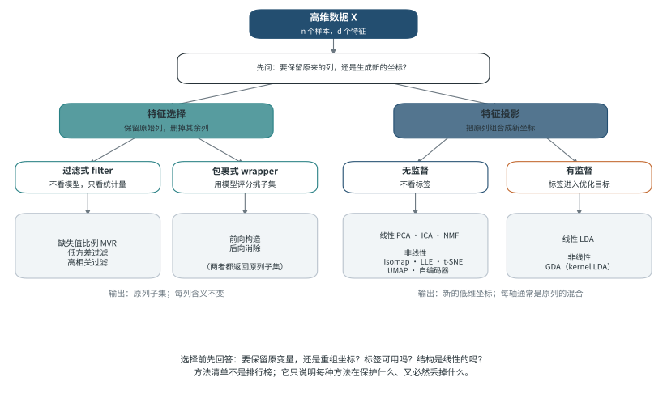
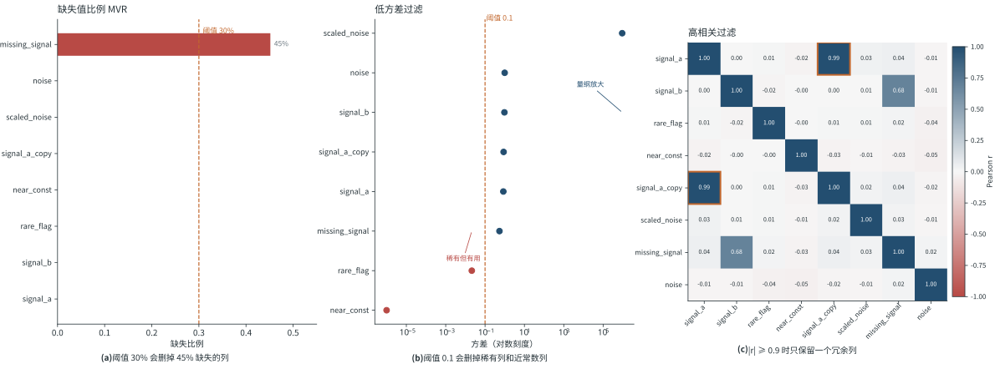
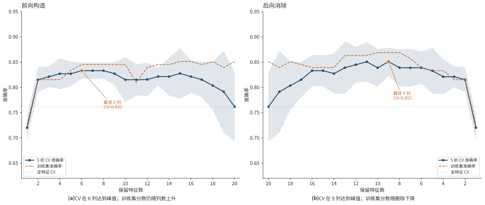
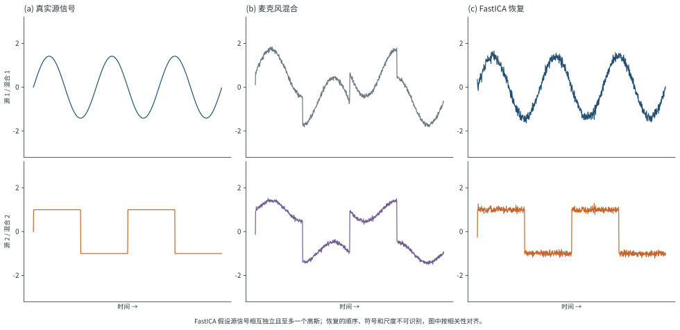
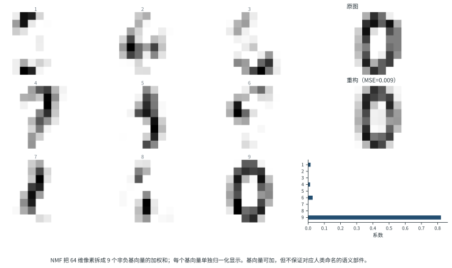
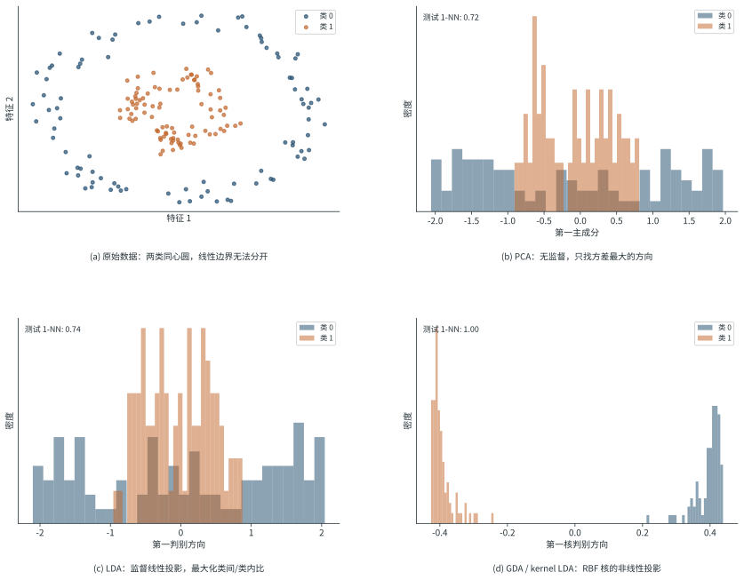
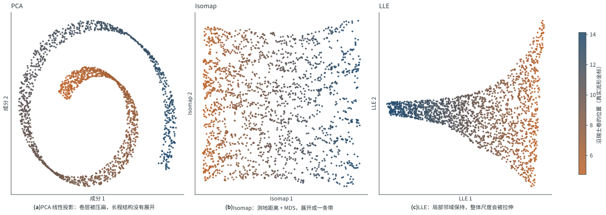
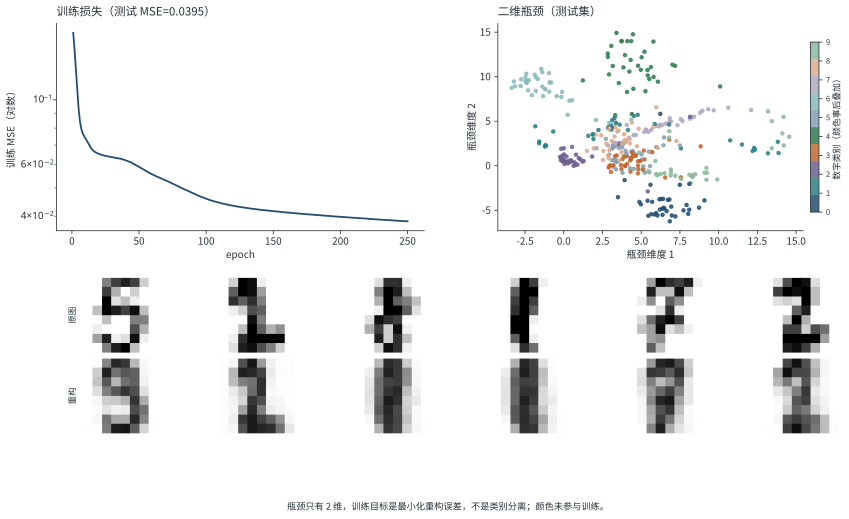

降维方法常被列成一张十二项清单，仿佛它们是同一任务的不同解法。实际并非如此：有的方法只是删掉列，有的把列组合成新坐标，有的让标签参与坐标优化，还有的假设数据躺在一张弯曲的曲面上。先确认输出是什么，再记方法名字，通常更省时间。

> 降维不是「把维数变小」这一个动作，而是「决定保留哪种结构，并接受其余结构被破坏」。

本文按四个问题组织：输出是否保留原列、标签是否参与、结构是否线性、方法保护的是全局距离还是局部邻域。t-SNE、UMAP 与 PaCMAP 的图形阅读已在 [[dimensionality-reduction-visualization|另一篇笔记]]中展开，这里只在选择清单里指路，不重复解释。

## 一、先问输出：原列还是新坐标

设数据矩阵为 $X\in\mathbb{R}^{n\times d}$，$n$ 是样本数，$d$ 是特征数。降维要得到一个更小的表示，但「更小」可以指两件不同的事。

- **特征选择**输出原矩阵的一个列子集 $X_{S}$，$S\subset\{1,\dots,d\}$。每一列的含义不变，模型仍能说「第 7 个变量重要」。
- **特征投影**输出新坐标 $Z\in\mathbb{R}^{n\times k}$，$k<d$。每个新轴通常是原列的线性或非线性组合，通常不能再按单个原变量解释。

这两种输出的下游用法不同。需要向业务方解释「哪个指标在起作用」时，删列更容易交代；只关心压缩、去噪或可视化时，新坐标更灵活。

图里的分支不是分类学，而是一组要先回答的问题。

1. **下游还要解释原始变量吗？** 要，就优先考虑特征选择；不要，才考虑投影。
2. **标签可用吗？** 标签进入目标函数会改变「好坐标」的定义。LDA 与 PCA 的差别不在实现，而在优化目标。
3. **结构是线性的吗？** 若数据在原始空间中近似线性，PCA、LDA 足够；若弯曲，线性投影会把不同区域压在一起。

还有一个容易混淆的量：**内在维度**（intrinsic dimension）。它指数据自身有多少个自由度，和人为设定的输出维数 $k$ 不是一回事。$k$ 是超参数，内在维度是需要估计或假设的量。把 $k$ 设成 2 只说明图方便看，不说明数据真的二维。

## 二、维度为什么成为问题

高维的第一个麻烦是样本稀疏。$d$ 个维度上各取 10 个格点，就需要 $10^{d}$ 个样本才能填满；固定样本量下，点与点的平均距离随维度上升，局部邻域变得越来越空。

第二个麻烦是距离集中。Beyer 等人在 1999 年证明，在某些分布假设下，随着维度增加，最近邻与最远邻的距离比趋近于 1：所有点看起来差不多远，基于距离的检索和聚类会退化。[@beyerNearestNeighborMeaningful1999] 这解释了一个常见现象：同一套 $k$-NN 或 t-SNE 参数，在 10 维数据上工作良好，换到 500 维就失去分辨力。

但高维本身不是原罪。若每个特征都携带独立信号，删维就是丢信息。降维方法隐含一个假设：数据存在低维结构，或者特征之间存在冗余。这个假设不成立时，任何降维都只是有损压缩。

## 三、特征选择：输出仍是原来的列

### 3.1 过滤式：先算统计量，不看模型

过滤式方法给每一列打一个分，再按阈值或排名保留。它便宜、可解释，但只看单列，看不到特征之间的交互。

**缺失值比例（MVR）。** 图中 `missing_signal` 有 45.2% 的缺失，按 30% 阈值会被整列删除。但这一列与目标 $y$ 的相关系数是 0.381（在中位数填补后计算），删掉它会损失真实信号。是否删除取决于缺失机制：完全随机缺失（MCAR）、依赖其他变量的缺失（MAR）和依赖未观测值的缺失（MNAR）对应不同处理。缺失值本身也可能是有信息的，例如「未填写」往往与风险相关。[@littleStatisticalAnalysisMissing2019]

处理缺失不只有「删列」一个选项：填补、把缺失指示单独作为一列、或用能处理缺失的模型，都可以保留信息。原文提到的「20% 到 60%」阈值只是经验区间，不是统计定律。

**低方差过滤。** 图中 `near_const` 的方差是 $9.9\times10^{-7}$，几乎是常数，删掉合理；`rare_flag` 的方差只有 0.0212，却对目标有实质贡献，删掉就不合理。两者的差别不在方差大小，而在「小方差是否等于没信息」。

还有一个更基础的问题：方差依赖量纲。`scaled_noise` 只是把噪声乘了 1000，方差就变成 930,100，看起来比任何信号都「重要」。**比较方差之前必须先统一量纲**，否则低方差过滤只是在筛选单位。

**高相关过滤。** 图中 `signal_a_copy` 与 `signal_a` 的相关系数是 0.987。保留一个、删掉另一个通常不会损失太多信息，但「保留哪一个」需要领域判断：两列可能测量相近却不完全相同的量，删错会让模型失去一个有用的视角。相关也不等于冗余，非线性关系、条件作用和交互项都不会出现在 Pearson 相关系数里。

这三条规则共同的边界是：它们是**单变量启发式**。阈值应当写下，并做敏感性检查；把阈值当成默认真理，比不删列更危险。

### 3.2 包裹式：用模型分数搜索子集

包裹式方法把「选哪些列」当成搜索问题：用交叉验证分数评价每个候选子集，逐步加入或删除特征。

在这份合成数据上（240 个样本、20 个特征、5 折交叉验证、逻辑回归），两种贪心搜索给出不同的子集。

| 策略 | 保留列数 | 交叉验证准确率 | 训练集准确率 | 留出测试集准确率 |
| --- | --- | --- | --- | --- |
| 前向构造 | 6 | 0.833 | 0.845 | 0.750 |
| 后向消除 | 9 | 0.851 | 0.869 | 0.792 |
| 全部特征 | 20 | 0.762 | — | 0.708 |

三点比表格里的高低更重要。

第一，**两条路径没有停在同一个子集**。前向从空集开始，每次加入当前最好的列；后向从全集开始，每次删掉最不重要的一列。贪心搜索只看一步，无法保证全局最优，也不保证两种方向收敛到同一答案。

第二，**训练集分数不能用来选特征数**。前向曲线的训练分数随列数增加而上升，交叉验证曲线却在 6 列附近达到峰值。若按训练分数选，最终会保留越来越多列，把噪声也拟合进去。

第三，**测试集只用一次**。表中测试准确率是在子集确定之后才计算的。72 个测试样本下，0.750 与 0.792 只差 3 个样本，不足以证明后向消除更好。更严格的做法是嵌套交叉验证：外层估计泛化误差，内层做特征搜索；否则交叉验证分数本身也带选择偏差。[@kohaviWrappersFeatureSubset1997; @guyonIntroductionVariableFeature2003]

包裹式的代价是计算量。$d$ 个特征的前向搜索最多拟合 $O(d^{2})$ 次模型，后向同理；特征上千时，通常先用过滤式缩小候选集，再用包裹式精挑。

### 3.3 特征选择的证据边界

特征选择最容易出错的地方不在算法，而在流程。只要用全部数据算过方差、相关系数或模型分数，再切分训练集和测试集，测试集就已经间接参与了选择。正确顺序是：先切分，所有选择步骤只在训练集内完成，最后在测试集上评估一次。

报告时也应写清楚搜索空间和停止规则，而不只是「最终保留了 9 个特征」。换一个随机种子或换一种模型，子集可能变化；这不是实现 bug，而是小样本选择问题本身的不稳定性。

## 四、无监督线性方法：没有标签，只由数据决定坐标

这一组方法都不使用标签，输出由线性变换或线性分解得到。它们的分歧在于把什么当作「要保留的结构」：方差、统计独立性，还是非负的加法部件。

### 4.1 PCA：寻找方差最大的正交方向

主成分分析（PCA）寻找一组正交方向，使投影后的方差依次最大。第一主成分是协方差矩阵最大特征值对应的特征向量，第二主成分在剩余的正交方向中重复这一过程。[@pearsonLinesPlanesClosest1901; @hotellingAnalysisComplexStatistical1933]

PCA 有两个等价说法：最大化投影方差，或最小化线性重构误差。后者解释了它为什么会丢信息：只用前 $k$ 个成分重构时，被丢弃的是方差最小的方向。

使用 PCA 时有几个必须写进方法的细节。

- **是否标准化。** 方差依赖量纲。像素、金额和温度直接混在一起时，量纲大的列会主导主成分。通常先标准化，除非各列本来同单位、且你希望大方差列占更大权重。
- **保留多少成分。** 解释方差比、碎石图、重构误差和下游任务指标都可以用，但「累计 95%」同样是启发式，不是定理。
- **载荷怎样解释。** 载荷把主成分轴翻译回原始变量，适合形成假设；主成分的符号可以整体翻转，单个载荷的大小还受其余变量尺度与相关性的影响，不能当作唯一的重要性分数。
- **线性边界。** 数据若沿弯曲流形分布，PCA 会把不同区域压到同一位置。瑞士卷例子见第六节。

PCA 图的阅读方式、监督与无监督投影的区别、t-SNE 的稳定性检查，已在 [[dimensionality-reduction-visualization|降维可视化笔记]]中详细讨论。

### 4.2 ICA：寻找统计独立的源

独立成分分析（ICA）假设观测是若干相互独立、非高斯的源信号的线性混合，目标是恢复这些源。[@comonIndependentComponentAnalysis1994] 经典例子是鸡尾酒会：两个麦克风录到的是两个人说话的混合，ICA 试图把两路声音分开。

图中两个源分别是正弦波和方波。FastICA 恢复后与真实源的对齐相关系数为 0.994 和 0.997。[@hyvarinenFastRobustFixed1999]

ICA 与 PCA 的差别在于目标。PCA 让成分两两不相关，二阶统计量足够；ICA 要求更高阶的统计独立。不相关不等于独立：两个变量可以完全不相关，却仍有明显的非线性依赖。

ICA 有几个不可识别的自由度，必须提前知道：

- **顺序不可识别。** 恢复的成分没有固定编号，交换两列仍是同一组解。
- **符号不可识别。** 每个成分可以整体乘 $-1$。
- **尺度不可识别。** 成分可以乘任意常数，只要混合矩阵相应缩放。
- **高斯源不可分。** 至多只能有一个高斯源；两个高斯源的线性混合仍然是高斯，无法靠独立性区分。

因此 ICA 不是通用的压缩工具。它适合「观测是独立过程的叠加」这一结构，例如音频分离、脑电伪迹分离、部分图像去噪。若源并不独立，或者高斯性很强，ICA 的输出不会比 PCA 更有解释力。

### 4.3 NMF：非负约束下的部分相加

非负矩阵分解（NMF）把非负矩阵 $X$ 近似为两个非负矩阵的乘积：

$$
X \approx WH,\qquad W\in\mathbb{R}^{n\times k}_{\ge 0},\quad H\in\mathbb{R}^{k\times d}_{\ge 0}.
$$

$H$ 的每一行是一个基向量，$W$ 的每一行是对应的系数。非负约束使表示变成「加法组合」：一个样本由若干部件叠加而成，而不是正负相消。[@leeLearningPartsObjects1999; @leeAlgorithmsNonNegativeMatrix2001]

在 1797 个 8×8 手写数字上取 9 个成分，单样本重构的均方误差是 0.00872，全体样本是 0.02723。基向量中能看出笔画片段，但**不要把它们直接命名为「横」「竖」「圈」**。NMF 只保证非负分解与重构误差，不保证基向量对应人类语义。成分数、初始化和局部最优都会改变结果；同一份数据换一个随机种子，基向量可能重排或合并。

原文提到的「Sequential NMF」不是标准术语。常见做法是「先做某种预处理或降维，再做 NMF」，或者「逐层/逐步增加成分」，但这些是流程组合，不是与 PCA、ICA 并列的独立算法。遇到这个名称，应当追问具体步骤，而不是把它当成一个已定义的方法。

## 五、有监督投影：标签进入目标函数

### 5.1 LDA：最大化类间与类内散度之比

线性判别分析（LDA）寻找一个线性投影，使投影后类间散度尽可能大、类内散度尽可能小。[@fisherUseMultipleMeasurements1936] 对 $C$ 个类别，LDA 最多给出 $C-1$ 个判别方向；二分类时只有一维。

这解释了一个常见现象：十分类手写数字用 LDA 降到二维，只用到 $9$ 个可用方向中的前两个；想再要更多判别方向，数学上不会产生新的类间信息。

LDA 的经典推导假设各类服从高斯分布且协方差相同。这个假设主要影响**分类推断的最优性**，不影响投影本身的定义：即使假设不成立，类均值与类内协方差仍然可以算出判别方向，只是「为什么这样最好」的解释变弱。样本少、维度高时，类内协方差估计不稳定，通常需要收缩估计或正则化。

LDA 最大的实践风险是标签泄漏。若先用全部样本（包括测试集）计算类均值和协方差，再做交叉验证，测试集信息已经进入投影。正确做法是把 LDA 放进管道，只在训练折上拟合。

### 5.2 GDA 与 kernel LDA：先确认缩写指什么

Encord 文章把「GDA」列为一种降维方法。这里的 GDA 指 **Generalized Discriminant Analysis**，即用核方法做 LDA，由 Baudat 与 Anouar 在 2000 年提出。[@baudatGeneralizedDiscriminantAnalysis2000] 它通过核函数隐式地把样本映射到高维特征空间，再在那个空间里最大化类间/类内散度比。

「GDA」这个缩写同时被用于 **Gaussian Discriminant Analysis**（高斯判别分析），后者是一个生成式分类器，不是降维方法。读到这三个字母时，必须看上下文：有核函数、有特征空间，才是 kernel LDA；有类条件高斯和贝叶斯决策，才是高斯判别分析。

两类同心圆数据上，线性方法无法用一条直线分开。PCA 与 LDA 的一维投影直方图仍然大幅重叠；RBF 核的 kernel LDA 把两类压到两端。测试集 1-NN 准确率分别是 PCA 0.722、LDA 0.744、kernel LDA 1.000。

这个 1.000 只描述当前教学设置：600 个样本、固定核参数 $\gamma=1$、正则化系数 $10^{-2}$、单一数据划分、用 1-NN 作为探针。它不能推出「kernel LDA 总比 LDA 好」。核宽度过大会退化为近似线性，过小会把每个点孤立成自己的类；核矩阵还有 $O(n^{2})$ 的存储与计算成本。真实任务中应把核参数放进交叉验证，并报告方差。

另外，Encord 在同一节提到 QDA（二次判别分析）。QDA 是分类器，不是降维方法；它允许每个类有不同协方差，产生二次决策边界。把它列进降维清单，是把「分类边界的形式」和「输出坐标的维数」混在了一起。

## 六、非线性流形学习：假设数据躺在曲面上

流形学习假设高维观测集中在一个维度更低、但可能弯曲的结构附近。瑞士卷是标准例子：一张二维长条被卷成三维螺旋，任意两点在高维空间中的直线距离会穿过空气，而沿曲面的距离才是「真实」距离。

### 6.1 Isomap：用邻域图估计测地距离

Isomap 分三步：为每个点找 $k$ 个最近邻，在邻域图上计算最短路径，把最短路径长度当作测地距离，再用经典多维缩放（MDS）求出低维坐标。[@tenenbaumGlobalGeometricFramework2000]

在这份 2000 点、噪声 0.01 的瑞士卷上，取 10 个邻居，Isomap 第一轴与真实流形位置的相关系数为 0.992，图层被展开成一条连续带。PCA 则把相邻卷层压得很近，颜色沿着螺旋走，但沿曲面的长程距离没有展开。

Isomap 的失败模式同样明确：

- **邻域图不连通。** 最短路径为无穷大，低维坐标没有定义。
- **短路边（short circuit）。** 邻居跨过卷层连接，测地距离被低估，展开结果出现折痕或碎片。
- **邻居数敏感。** 太小则图断裂，太大则跨层连接。噪声越大，可用的中间区间越窄。

### 6.2 LLE：保持局部线性重构权重

局部线性嵌入（LLE）换了一个要保护的量：每个点用邻居的线性组合重构，求出重构权重，再在低维空间中寻找保持这些权重的坐标。[@roweisNonlinearDimensionalityReduction2000]

LLE 不估计全局距离，只要求局部关系不变。代价是整体尺度、方向和簇间距离都可能改变。图中 LLE 把瑞士卷展开成扇形，局部邻域大体连续，但长程比例已经改变。这不是实现错误，而是目标函数只约束局部重构。

Isomap 与 LLE 都依赖邻域图，都对噪声和采样密度敏感。它们的低维坐标适合观察结构、生成假设，不适合直接当作物理坐标或距离度量。

### 6.3 t-SNE、UMAP 与评价

t-SNE 和 UMAP 也是非线性方法，但优化目标不同：前者匹配邻域概率，后者从邻域图构造低维布局。它们擅长显示局部簇，却会系统性地扭曲全局距离。具体机制、参数影响和图形阅读规则见 [[dimensionality-reduction-visualization|降维可视化笔记]]。

Encord 还提到 kernel PCA：它把 PCA 搬到核空间，和 kernel LDA 一样用核矩阵代替显式映射，区别是前者不使用标签。本文不展开它的推导。

评价流形展开质量不能只看图「好不好看」。常用指标包括 trustworthiness（原空间邻居有多少落在低维邻域）和 continuity（低维邻居有多少仍留在原空间邻域），以及下游任务上的独立指标。不同方法、不同邻居数、不同随机种子下的结果都应报告，而不是挑一张最整齐的图。

## 七、自编码器：用神经网络学习编码与解码

自编码器由一个编码器和一个解码器组成。编码器把输入压到低维瓶颈，解码器再从瓶颈重建输入；训练目标是最小化重构误差。[@rumelhartLearningRepresentations1986; @hintonReducingDimensionality2006]

$$
z = f_{\theta}(x),\qquad \hat{x}=g_{\phi}(z),\qquad \mathcal{L}=\lVert x-\hat{x}\rVert^{2}.
$$

瓶颈的维数就是降维后的维数。与 PCA 不同，编码器和解码器可以是非线性的，因此能表示弯曲的流形。

在 64 维手写数字上训练 64→32→2 的瓶颈网络，测试集重构均方误差为 0.0395；用瓶颈坐标做 1-NN 分类，准确率为 0.731。颜色是训练结束后才按真实标签叠加的，没有参与损失函数。

两个结论要分开说。重构误差低，说明二维瓶颈保留了画像素所需的大部分信息；1-NN 准确率 0.731，说明瓶颈中也有类别结构。但这两件事都不保证瓶颈的每个轴可解释，也不保证换个瓶颈维数仍有同样表现。二维是相当激进的目标：数字有 10 个类别，压到二维必然丢失细节。

自编码器也不是生成对抗网络（GAN）。自编码器学习「编码—重建」，目标是重构输入；GAN 学习「生成—判别」，目标是让生成样本骗过判别器。两者都涉及从低维向量到高维数据的映射，但训练目标和失败模式不同。把 GAN 当作自编码器的一种，会误解它的损失函数和评价方式。

实践上还要注意：线性自编码器配均方误差时，其瓶颈张成的子空间与 PCA 的前 $k$ 个主成分一致，这一等价关系有经典分析。[@bourlardAutoAssociationMultilayer1988] 非线性带来的额外表达能力，则需要用验证集证明它确实有用，而不是默认「更深更好」。瓶颈太小会欠拟合，太大则退化为恒等映射；正则化、噪声注入和稀疏约束都是常见的控制手段。

## 八、一张选择清单

| 你先确认的事 | 可选方法 | 输出 | 主要代价 |
| --- | --- | --- | --- |
| 必须保留原始变量含义 | 过滤式、包裹式特征选择 | 原列子集 | 可能漏掉交互；包裹式计算贵 |
| 线性结构、无标签、要压缩或去噪 | PCA | 正交新坐标 | 弯曲结构会重叠；对量纲敏感 |
| 观测是独立非高斯源的混合 | ICA | 独立成分 | 顺序/符号/尺度不可识别；高斯源不可分 |
| 数据非负、希望「部分相加」 | NMF | 非负基与系数 | 局部最优；基向量不保证语义 |
| 有标签、线性可分性足够 | LDA | 最多 $C-1$ 维判别坐标 | 小样本协方差不稳；标签泄漏风险 |
| 有标签、边界明显非线性 | kernel LDA（GDA） | 核空间判别坐标 | 核参数与 $O(n^{2})$ 成本 |
| 弯曲流形、需要全局展开 | Isomap | 测地坐标 | 邻域图断裂或短路 |
| 弯曲流形、只关心局部关系 | LLE | 局部重构坐标 | 全局尺度不保留 |
| 大样本、只需要可视化 | t-SNE、UMAP | 二维/三维布局 | 全局距离被扭曲；参数敏感 |
| 数据量大、可训练、需要非线性编码 | 自编码器 | 瓶颈表示 | 训练不稳定；瓶颈维数难选 |

这张表只能排除明显不合适的方法，不能替你做最终选择。真正的依据是：方法保护的结构是否与任务需要的结构一致，以及这个保护关系能否被独立指标检验。

## 九、常见误读与本文的取舍

1. **「Sequential NMF 是一种独立降维方法。」** 不是标准术语。它通常指某种预处理或逐层流程；遇到时应追问具体步骤。
2. **「GDA 就是高斯判别分析。」** 在降维语境里，GDA 可能指 Generalized Discriminant Analysis，即 kernel LDA；高斯判别分析则是分类器。看到缩写要先确认论文定义。
3. **「自编码器就是 GAN。」** 两者目标不同：重构与生成对抗不是同一件事。
4. **「缺失值超过 20%–60% 就该删列。」** 这是经验区间，不是规则。缺失机制、缺失本身的信息量和下游任务都会改变判断。
5. **「方差小的特征一定没用。」** 稀有事件、二值标志和低幅值信号都可能方差很小但预测力很强。比较前先统一量纲。
6. **「相关系数高就可以随便删一列。」** 保留哪一列需要领域判断；相关也不覆盖非线性依赖。
7. **「LDA 的高斯假设不成立就不能用。」** 假设主要影响分类最优性的解释；投影本身仍可计算，只是需要正则化和验证。
8. **「降维图能证明模型好坏。」** 图只能提出假设。模型性能要在独立测试集上按任务指标评估。

## 十、证据边界

本文七组教学示例和一张方法地图都由 `scripts/generate_dimred_method_figures.py` 生成，随机种子固定，可重复执行。数据是合成表格数据、同心圆、瑞士卷和 scikit-learn 自带的手写数字，不构成统一基准。

- 每个示例只用一个数据划分，没有做超参数搜索；表中的数字描述当前设置，不是方法排名。
- 包裹式示例的测试集只有 72 个样本，几个百分点的差异可能只对应两三个样本。
- kernel LDA 的 1.000 来自一个线性不可分、核方法占优的教学数据，不能外推。
- 自编码器的 1-NN 准确率只是探针，不是表示质量的完整评价。
- 所有图的坐标轴、颜色和随机种子都会影响观感；结论应来自指标和重复实验，而不是单张图。

把这些方法放回机器学习流程，可继续读[[dimensionality-reduction-visualization|降维可视化笔记]]，或回到[[Deep Learning|深度学习概览]]。

## 参考文献
