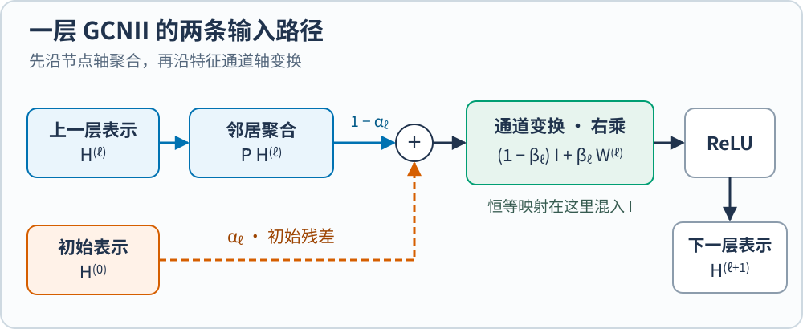
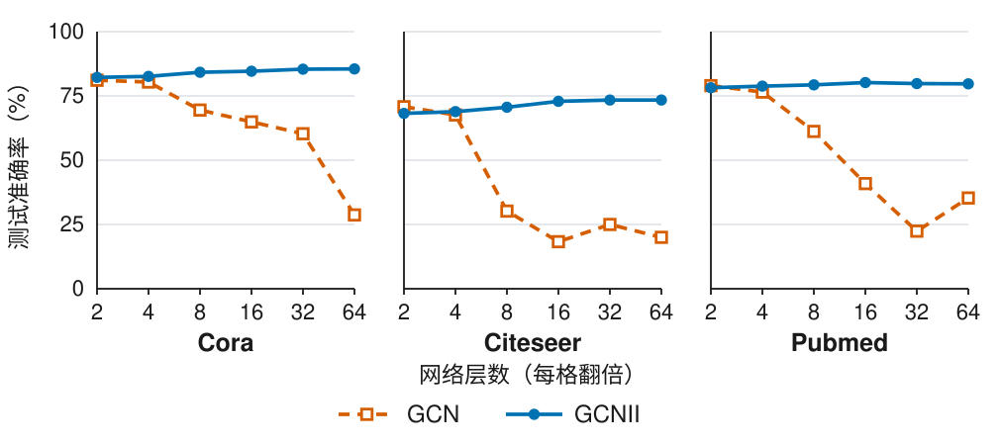

**GCNII 在每一层重新引入节点的初始表示，并以恒等矩阵为参照学习通道变换。** 这样，模型可以利用多轮邻居传播，同时让每层直接用到节点自己的初始信息。这个架构由 Ming Chen、Zhewei Wei、Zengfeng Huang、Bolin Ding 和 Yaliang Li 在 ICML 2020 提出。[@chenSimpleDeepGraph2020]

[PMLR 正式版](https://proceedings.mlr.press/v119/chen20v.html) · [论文 PDF](https://proceedings.mlr.press/v119/chen20v/chen20v.pdf) · [作者代码](https://github.com/chennnM/GCNII)

## 多传播几次，为什么节点会变得难区分

图卷积网络（GCN）通过邻居聚合更新节点表示。一层传递一跳信息；叠加多层后，节点可以接触到更远的邻居。反复聚合也会削弱节点间原有的差异，当这些差异难以从表示中恢复时，就出现了**过平滑**。早期 GCN 在论文关注的节点分类实验中多采用浅层结构，层数增加也不一定提高准确率。[@kipfSemiSupervisedClassification2017; @chenSimpleDeepGraph2020]

用一个四节点环理解这个过程。每个节点与左右邻居相连，也保留自己的值；每轮取这三个值的平均。初始值是 $(2,2,0,0)$，平均值为 1。只做传播时，一轮后变成 $(4/3,4/3,2/3,2/3)$：两组节点的差从 2 缩到 $2/3$。这个例子中，每轮都把偏离平均值的部分缩到原来的 $1/3$，最后只剩共同的平均值。

一般的不规则图还保留与度数有关的缩放。原论文 §4.1 的定理 1 研究的是一个**线性化、带相邻层残差的传播**：在连通无向图加自环后，反复乘 $Q=(I_n+\tilde P)/2$，表示趋向由自环后度数平方根确定的共同方向。也就是说，各节点的行可以相差度数尺度，主要的节点特征差异仍被压缩。这个极限有明确的传播条件，不能直接套到带任意权重和激活的训练模型。[@chenSimpleDeepGraph2020]

## 一层 GCNII 做哪几步

设 $A$ 是 $n$ 个节点的邻接矩阵，$\tilde A=A+I_n$ 加入自环，$\tilde D$ 是 $\tilde A$ 的度矩阵。对称归一化传播矩阵为 $\tilde P=\tilde D^{-1/2}\tilde A\tilde D^{-1/2}$。第 $\ell$ 层表示 $H^{(\ell)}\in\mathbb R^{n\times d}$，其中 $d$ 是隐藏通道数。初始表示 $H^{(0)}$ 可以来自输入特征 $X$ 的一次投影，在传播层之间反复引用。原文式（5）可以拆成两步：[@chenSimpleDeepGraph2020]

$$
S^{(\ell)}=(1-\alpha_\ell)\tilde P H^{(\ell)}+\alpha_\ell H^{(0)},
$$

$$
H^{(\ell+1)}=\operatorname{ReLU}\!\left(S^{(\ell)}\big[(1-\beta_\ell)I_d+\beta_\ell W^{(\ell)}\big]\right).
$$

*图 1。依据 Chen 等（2020）式（5）原创绘制。蓝色实线路径来自上一层；橙色虚线路径直接引用初始表示。两支在加法节点汇合。*

### 初始残差：每一层都重新取用起点

$\alpha_\ell$ 控制初始表示在混合结果 $S^{(\ell)}$ 中的份额。两支都是 $n\times d$ 矩阵，因此这里是逐元素加权相加。相邻层残差拿的是 $H^{(\ell)}$；GCNII 每次拿同一个 $H^{(0)}$，所以节点不必只从已经传播多次的表示恢复自身特征。[@chenSimpleDeepGraph2020]

回到四节点环，只隔离这项设计：每轮用 $0.9$ 倍邻居平均加上 $0.1$ 倍初始值。若第 $k$ 轮相对均值 1 的偏离幅度是 $c_k$，则 $c_{k+1}=0.3c_k+0.1$。它趋向 $1/7$ 而非零，最终两组值为 $1+1/7$ 和 $1-1/7$。这说明重复注入可以保留这个例子的差异；完整 GCNII 还包含通道变换和 ReLU。

### 恒等映射：用恒等项调节通道变换

右乘的单位矩阵作用在通道轴，因此这里记作 $I_d$；在邻接矩阵上加自环用的是节点轴上的 $I_n$。将有效矩阵写成 $I_d+\beta_\ell(W^{(\ell)}-I_d)$，就能看出 $\beta_\ell$ 怎样缩放它相对恒等矩阵的偏离。作者实现中，编号为 $k\geq1$ 的传播层用 $\beta=\log(1+\lambda/k)$，$\lambda$ 是控制强度的超参数。[作者实现](https://github.com/chennnM/GCNII/blob/master/model.py)；[@chenSimpleDeepGraph2020]

恒等分支传递的是**已经混合的** $S^{(\ell)}$。它提供了一条较少改变通道组合的路径，整个层仍包含图传播和激活。因此，式（5）本身并不保证所有信息都能跨层保留，也不保证梯度永不衰减。

两项设计合在一起，还有一个谱域解释。论文 §4.2 的定理 2 给出了 $K$ 层 GCNII 表达 $K$ 阶图多项式滤波器的构造；多项式系数可以控制不同传播阶数的贡献。它说明架构可表达的滤波器比固定的重复传播更丰富，实际学到哪一种还取决于参数、数据和训练。[@chenSimpleDeepGraph2020]

## 32 层和 64 层的证据来自哪里

原论文 §6.1 的表 3 在 Cora、Citeseer、Pubmed 三个固定划分的半监督节点分类任务上比较不同深度。下面只重绘表中 GCN 和 GCNII 两行，便于看清同一数据集上深度变化的影响。[@chenSimpleDeepGraph2020]

*图 2。根据 [Chen 等（2020）表 3](https://proceedings.mlr.press/v119/chen20v/chen20v.pdf#page=7) 的准确率重新绘制。横轴按倍增层数等距排列，三组使用相同的百分比纵轴；仅表示论文报告的数值。*

### 为什么 Cora 的峰值在 64 层，Pubmed 在 16 层

**64 和 16 是这组候选深度里测试准确率最高的位置。** 表 3 中，Cora 的 GCNII 从 16 层的 84.6% 到 32 层的 85.4%，64 层再到 85.5%；Pubmed 则从 16 层的 80.2% 到 32 层的 79.8%、64 层的 79.7%。Citeseer 的 32 和 64 层在表中都报告 73.4%。换句话说，Cora 到了 32 层以后增幅也已很小。[@chenSimpleDeepGraph2020]

深一层，节点就多一次聚合机会，但新增的邻居信息有多少能帮助辨别论文主题，取决于词袋特征、引用关系和标签如何分布。**一种待检验的解释**是，Cora 在更深处仍能利用额外线索，Pubmed 则较早耗尽新增邻域带来的收益。多做聚合也可能混入无关主题。论文没有测量各跳邻域对分类的增量贡献，因此无法从曲线确定这一解释。表 1 的节点数（2,708 与 19,717）和类别数（7 与 3）描述了两项任务的差异，但不能单凭这些数字推算最合适的传播深度。[@chenSimpleDeepGraph2020]

调参和监督设置也要一起看。§6.1 按验证集准确率为不同深度调参，表 3 比较的是各自训练的模型，而非从同一个 64 层模型逐层读出结果。[补充表 6](https://proceedings.mlr.press/v119/chen20v/chen20v-supp.pdf#page=2)所列的 Cora 64 层和 Pubmed 16 层配置，在隐藏通道数、dropout 和 $\lambda$ 上都不同。作为对照，论文在**全监督** Pubmed 实验中报告的是 64 层 GCNII（补充表 7）。训练、验证和测试的划分及配置都变了，所以这项结果说明 16 层并非 Pubmed 的固有上限，但没有单独确定是哪一项变化带来的差异。[@chenSimpleDeepGraph2020]

### Pubmed 的准确率回落，能诊断过平滑吗

**不能只凭这条曲线诊断。** 80.2% 到 79.7% 相差 0.5 个百分点。表 2 报告了 16 层配置运行 100 次的结果：均值为 80.2%，标准差为 0.4 个百分点。表 3 未给出 64 层的逐次结果或标准差，不能只用 16 层的波动判断差距是否稳定。作者在 §6.1 强调的是 Pubmed 加深到 64 层后仍保持相近准确率，并把这种保持归因于恒等映射；这与解释那 0.5 个百分点为何下降是两个问题。[@chenSimpleDeepGraph2020]

[原论文图 1 和图 2](https://proceedings.mlr.press/v119/chen20v/chen20v.pdf#page=9)分别按节点度分组报告准确率、比较初始残差和恒等映射的消融。图 2 中两项合用的模型在深层保持较高准确率，但两个图的纵轴都是分类准确率。测试分数也会受训练波动、优化和正则化等因素影响，图中没有提供 Pubmed 的逐层表示证据来区分这些解释。[@chenSimpleDeepGraph2020]

如果要验证**定理 1 描述的那种趋同**，可以记录同一批节点在各层的表示 $H^{(\ell)}$，在每个连通分量内用该分量的表示和度数计算：

$$
R_\ell=\frac{\left\lVert H^{(\ell)}-uu^\top H^{(\ell)}\right\rVert_F^2}{\left\lVert H^{(\ell)}\right\rVert_F^2},
\qquad u_i=\frac{\sqrt{\tilde d_i}}{\sqrt{\sum_j\tilde d_j}}.
$$

$u$ 是由自环后的度数 $\tilde d_i$ 定义的单位向量，$\lVert\cdot\rVert_F$ 是矩阵元素平方和的平方根。对非零表示，$R_\ell$ 衡量稳态方向以外的分量占比；为零时，各节点的表示除以度数平方根后完全相同。全零表示则单独记录。接下来要看不同类别是否更难区分，例如冻结各层表示，用训练节点拟合同规格的线性分类器，再在留出的节点上评价。最后，在相同划分、相同训练协议下用多个配对随机种子比较 16 与 64 层，报告准确率差和不确定性。如果表示趋同、类别更难区分和准确率下降同时反复出现，过平滑就是更有证据的解释。这里是根据定理设计的诊断建议，论文没有报告这组测量。[@chenSimpleDeepGraph2020]

## 读深层 GCN 的三个问题

读到“加深网络”时，先问每层**沿哪个轴**操作，再看节点自己的初始信息**从哪里回到本层**，最后检查**深度实验测量了什么**。GCNII 的层公式分别回答了前两问；深度表和消融图给出第三问在特定任务上的证据。更大的传播半径提供利用远处信息的机会，最合适的层数仍要按实际任务验证。
